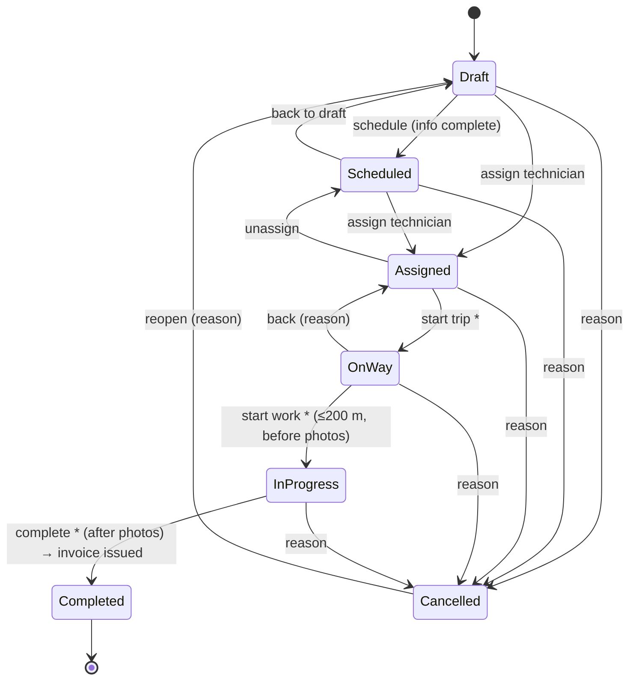

# Visit Proof — System Design

How the Visit Proof app works: what each part is for, how the parts talk to each other, and the rules that keep the data correct.

**How to read this:** every section opens with an **In short** box. Read only those boxes for a 5-minute overview, and the full sections when you work on that area. Concepts come before file names, and file links are at the end of each section.

---

## 1. The whole system in one page

> **In short:** Visit Proof is a Flutter app for field-service companies. An **admin** plans visits to clients and assigns technicians. A **technician** goes to the site and proves each step with live GPS and camera photos. Each visit has one invoice, and money a technician collects waits for the admin to confirm it. There is no server yet: every "remote" data source saves JSON on the device, behind interfaces that a real API can replace later.

```
           ┌─────────────── one Flutter codebase ───────────────┐
           │                                                     │
 Admin ───►│  Admin app (dashboard, dispatch, visits, invoices,  │
           │  clients, technicians, services)                    │
           │                                                     │──► SharedPreferences (JSON)
 Tech  ───►│  Technician app (my visits, start trip → work →     │──► Photo files on disk
           │  complete, collect payment)                         │──► GPS + camera
           │                                                     │
 Visitor ─►│  Wizpo website (web build only: landing, design     │
           │  studio, install as PWA)                            │
           └─────────────────────────────────────────────────────┘
```

Five ideas explain most of the code:

| Idea | Meaning |
|---|---|
| **Layers** | Screen → Bloc → Use case → Repository → Data source. Each layer only knows the one below it. |
| **Rules live in two places** | Rule classes (`VisitRules`, `DispatchRules`) decide what the UI *shows*. Data sources check the same rules again before they *save*. |
| **Visit ⇄ invoice** | Always one invoice per visit, written together, so they never disagree. |
| **Proof** | Every technician step carries a fresh location, a distance to the site, and photos where required. All of it goes into the visit history. |
| **Pending money** | A technician's collection is "pending" until the admin confirms it. Only confirmed money counts as paid. |

---

## 2. The product in plain words

> **In short:** a company has **clients** (each with sites and equipment), **services** (with a price, duration and checklist), and **technicians**. A **visit** links them: this client, at this site, for this service, by this technician, at this time. Each visit moves through a fixed set of statuses, and each has one invoice.

### Actors

| Actor | How they enter | What they can do |
|---|---|---|
| **Admin** | Taps "Admin" on the first screen. There is no admin account yet. | Everything: plan, assign, edit, invoice, confirm payments, configure dispatch. |
| **Technician** | Signs in with the email and password the admin set for them. | Only *their own* visits: move them forward, add notes, collect payment. |
| **Website visitor** | Opens the web build. | Browses the Wizpo site, tries the app in a phone frame, designs and installs a branded copy. |

### Core objects

```
Client ──< Site            Service ──> Category
   │         │                │
   └────┬────┘                │
        ▼                     ▼
      Visit ◄─────────────────┘
        │  ├── Technician (optional until assigned)
        │  ├── History entries (every change, with who/when/where)
        │  └── Photos (before work / after work / note / receipt)
        ▼
     Invoice ──< Payment ledger entries (confirmed / pending / rejected / refunds)
```

---

## 3. Runtimes: one codebase, four ways to run

> **In short:** the same code runs as a phone app, a website, a customer's web app, or an installed PWA designed by a visitor. Two flags decide which: whether it runs on the web, and the `CUSTOMER_APP` build define.

| Build | How it is made | What opens | Data |
|---|---|---|---|
| **Mobile app** | `flutter run` (Android/iOS) | Role select → admin or technician app | Kept on the device |
| **Website** | `flutter build web` | Wizpo sales site + design studio with the live app in a phone frame | Wiped and re-seeded with demo data on every start |
| **Customer web app** | `--dart-define=CUSTOMER_APP=true` | Only the app, real GPS, no reset | Kept in the browser |
| **Installed design** | Link with `#app=<design>` (from the studio) | Only the app, with the visitor's brand fixed | Seeded once, then kept under its own storage prefix |

`DemoMode` (`lib/core/demo/demo_mode.dart`) answers the "which mode am I in?" questions: `isOn`, `testData`, `installedApp`, `simulateOnSite`.

GitHub Actions builds the website and the customer app and publishes both to GitHub Pages (`.github/workflows/deploy-web.yml`).

---

## 4. Architecture: the layers

> **In short:** Clean Architecture with BLoC. A screen sends an **event** to a **bloc**. The bloc calls a **use case**, which calls a **repository**, which calls a **data source**. The answer comes back as `Either<Failure, Result>`. The bloc puts it into its **state** and the screen redraws. GetIt (`sl`) wires everything together.

```
┌─────────────────────────────────────────────────────────────────────┐
│ PRESENTATION   Screen (BlocProvider + BlocBuilder)                  │
│                  │ add(Event)                 ▲ new State           │
│                  ▼                            │                     │
│                Bloc  ── one RequestState per operation ─────────────┤
├──────────────────│──────────────────────────────────────────────────┤
│ DOMAIN         Use case (one class per action + Parameters)         │
│                  │                                                  │
│                Base…Repo (abstract)   Rules (pure, no I/O)          │
├──────────────────│──────────────────────────────────────────────────┤
│ DATA           …Repo (catches ServerException → Left(ServerFailure))│
│                  │                                                  │
│                Base…RemoteDataSource ← swap this for a real API     │
│                  │   validates, writes, appends history             │
│                  ▼                                                  │
│                SharedPreferences / files / GPS / camera             │
└─────────────────────────────────────────────────────────────────────┘
```

### One request, end to end ("technician starts work")

1. **Screen:** the technician taps *Start work*. The sheet collects a location and before photos, then sends `ChangeVisitStatusEvent(parameters)`.
2. **Bloc:** sets `changeStatusRequestState = loading` and calls `ChangeVisitStatusUc(parameters)`.
3. **Use case:** passes the call to `BaseVisitDetailRepo.changeVisitStatus`.
4. **Repository:** calls the data source inside `try/catch`. A `ServerException` becomes `Left(ServerFailure.openFun(message))`, which shows the error toast by itself.
5. **Data source:**
   - waits `AppLatency.local` (60 ms) to act like a network;
   - takes the write lock;
   - re-checks the rules (own visit? allowed move? within 200 m? photos present?);
   - updates the invoice if needed;
   - appends a history entry;
   - saves the invoice first, then the visit.
6. **Back up:** `Right(updatedVisit)` reaches the bloc. The state becomes `loaded` with the new visit, the screen redraws, and the success toast shows.

### Why it is built this way
- **The backend can be swapped.** Only data sources touch storage, so a real API replaces them without touching the screens or blocs.
- **Errors are uniform.** Data sources throw; repositories convert; blocs never show errors themselves.
- **Rules can be tested.** Rule classes are pure functions with tests in `test/`.

**Files:** `lib/core/usecase/base_use_case.dart`, `lib/core/network/error/`, `lib/core/services/services_locator.dart`.

---

## 5. Feature map

> **In short:** each feature is a folder under `lib/features/` with `data/`, `domain/` and `presentation/`. Some features only have screens and borrow logic from others.

| Feature | Responsibility | Has its own data? |
|---|---|---|
| `auth` | Role select, technician sign in, session restore, log out | Yes (session) |
| `main_menu` | Admin shell: drawer and tabs | Screens only |
| `technician_home` | Technician's "My visits" | Screens only (reuses `VisitsBloc`) |
| `visits` | Visit list, and the shared visit models | Yes (read only) |
| `add_visit` | Create a visit together with its invoice | Yes |
| `visit_detail` | Everything done *to* a visit: status, assign, reschedule, edit, notes, delete | Uses `visits` + `invoices` models |
| `invoices` | Invoice detail, issue, edit draft, record payment, refund, review collections | Yes |
| `dispatch` | Planning board, suggestions, bulk assign, rules, days off | Yes (settings, days off) |
| `dashboard` | KPIs, charts, insights, per-technician results | Read-only snapshot |
| `clients`, `technicians`, `services` | Directory CRUD (sites, equipment, categories) | Yes |
| `website` | Wizpo site, design studio, request form (web only) | Stub request source |

---

## 6. Core building blocks (`lib/core`, `lib/configs`)

> **In short:** shared services that every feature uses: who is signed in, dependency injection, error handling, storage, GPS, photos, theme, translations and branding.

| Block | What it does | Key file |
|---|---|---|
| **Session** | `AppSession.current` holds the role and technician. Everything asks it "admin or technician?". Only `auth` writes it; `main()` restores it. | `core/session/app_session.dart` |
| **Service locator** | GetIt `sl`. Blocs are factories (new for each screen); use cases, repos and data sources are lazy singletons. | `core/services/services_locator.dart` |
| **Errors** | `HandleLogicErrors` wraps data source bodies; `ServerException` → `ServerFailure` → toast. | `core/network/error/` |
| **Storage** | `LocalPref.sharedPreferences`: one JSON list per collection. | `core/local/local_pref.dart` |
| **Location** | `GFunLocation.current()`: live GPS only, rejects mock locations, explains each failure. | `core/utils/general_functions.dart/g_fun_location.dart` |
| **Photos** | Camera only (`GFunPhoto`), copied into `visit_photos/<visitId>/` (`LocalPhotos`). | `core/local/local_photos.dart` |
| **Theme** | `AppTheme`: light and dark palettes, font and size tokens, cached. Never hard-code colors. | `configs/app_theme.dart` |
| **Brand** | `AppBrand`: a customer's colors, font, name and logo layered on the theme. | `configs/app_brand.dart` |
| **Language** | `'text'.tr` / `.trArgs([...])`, English and formal Arabic, right-to-left aware. | `configs/app_language.dart`, `app_translations.dart` |
| **Enums** | Each enum has a `…Switch` helper: int id ⇄ enum ⇄ color ⇄ label. JSON stores the int. | `core/utils/enums/` |
| **Shared widgets** | `GWidget…` buttons, fields, sheets, dropdowns, map picker, and more. Reuse them first. | `core/utils/general_widgets/` |

---

## 7. Data model and storage

> **In short:** each collection is a list of JSON strings in SharedPreferences. A visit stores **copies** (snapshots) of its client, site, category and technician, so history stays correct when the originals change. Ids are UUIDs, and people-facing numbers are `VIS-000001` and `INV-000001`.

### Storage keys

| Key | Holds |
|---|---|
| `clients`, `technicians`, `services`, `categories` | Directory data |
| `visits` | `VisitDetailModel`: status, schedule, snapshots, history, photo paths, invoice id |
| `invoices` | `InvoiceDetailModel`: amounts, dates, payment status, client and site copies |
| `invoice_payments` | The payment ledger: one entry per payment, collection or refund |
| `dispatch_settings`, `technician_days_off` | Dispatch configuration |
| `session` | The signed-in role (a single JSON string) |

Photos are files on disk; visits keep their paths.

### Important modelling choices
- **Snapshots, not joins.** A visit embeds the client, site and technician *as they were*, and an invoice keeps its own copy of the site. Renaming a client does not rewrite old visits. A draft invoice follows site changes, an issued one does not.
- **Everything is nullable.** Models are hand-written Equatable classes with `fromJson`, `toJson` and `copyWith`. Getters supply defaults.
- **Status is duplicated on purpose.** A visit keeps a copy of its invoice's `paymentStatus`, so lists and the dispatch board don't have to load invoices.
- **Numbers.** `VIS-` and `INV-` plus 6 digits, the next number after the highest existing one.

---

## 8. The visit lifecycle

> **In short:** a visit moves draft → scheduled → assigned → on the way → in progress → completed, and can be cancelled from any open state. Admins plan the first half; technicians drive the second half. Some moves need a reason, and some change the invoice.


`*` = a step the technician can take, always with live proof (section 9).

### The rules behind the diagram
- **Technician presence matches the status.** Assigned and later states need a technician; scheduled must have none. A technician is added or removed only through *assign* and *unassign*, never through a status change or an edit.
- **Who can do what.** `VisitRules.nextStatuses` gives admins the full map. `technicianNextStatuses` gives technicians only the three forward steps, and only on visits assigned to them.
- **Reasons.** Cancel, reopen, and on the way → assigned need 8–500 characters.
- **Effects on the invoice:**
  - completing issues an untouched draft invoice, due in 14 days;
  - cancelling marks the invoice cancelled;
  - reopening makes it unpaid again;
  - cancelling is refused while confirmed money is still on the invoice.
- **Editing windows:**
  - site, schedule, technician and photo requirements: only before the technician leaves;
  - the service: only before dispatch, with an untouched invoice (the draft invoice is repriced);
  - notes: until the visit is closed.
- **Deleting:** only drafts or cancelled visits with nothing invoiced or paid.
- **History:** every change appends a `VisitHistoryModel` with the actor, time, description, an optional reason, location and distance from the site.

**Files:** `features/visit_detail/domain/rules/visit_rules.dart` (the rules), `features/visit_detail/data/datasource/visit_detail_remote_data_source.dart` (enforcement).

---

## 9. Field proof

> **In short:** the app does not take the technician's word for it. Every technician action captures a fresh GPS fix, which they confirm but cannot edit. Starting work requires being near the site, and photos come from the camera only.

| Check | Rule |
|---|---|
| Location freshness | Older than 3 minutes → taken again before saving (`maxLocationAge`) |
| Mock locations | Refused |
| Distance to start work | ≤ 200 m when the site has coordinates; otherwise the location is only logged |
| Before / after photos | Required at *start work* / *complete* when the visit asks for them; this setting locks once the technician is on the way |
| Photos per action | Up to 6, camera only |
| Consent | The technician ticks "I confirm this is my current location…" |
| Record | Location and distance are saved on the history entry; photos are tagged by kind (before, after, note, receipt) |

The UI shows these rules in the field proof panel. The data source checks them again, so a modified client still cannot skip them.

---

## 10. Money: invoices and the payment ledger

> **In short:** each visit has one invoice. An invoice is a **draft** until it is issued, either manually or automatically when the visit completes. Payments go into a **ledger**. Admin payments count right away; a technician's on-site collection is **pending** until the admin confirms it. All maths uses whole cents.

### Invoice life
```
created with the visit (draft, price from the service)
   │  admin may edit discount / tax / notes while draft
   ▼
issued (manually, or automatically on visit completion; due in 14 days)
   │
   ├── admin records a payment ─────────────► paidAmount ↑
   ├── technician collects on site ─► pending ─► admin confirms ─► paidAmount ↑
   │                                          └► admin rejects (reason) ─► removed from pending
   └── admin refunds ───────────────────────► paidAmount ↓
```

### Payment statuses
- `unpaid`
- `pending`: a field collection is waiting for the admin
- `partiallyPaid`
- `paid`
- `cancelled`: the visit was cancelled
- `refunded`

### Invariants checked on every invoice change
- Sum of confirmed ledger entries = `paidAmount`.
- Sum of pending ledger entries = `pendingAmount`.
- What can still be collected = remaining − pending, so a payment can never be counted twice.
- Amounts are converted to integer cents before comparing (`_cents`), so float rounding never breaks a check.

### Field collection (technician)
- **When:** only on the technician's own in-progress or completed visit with an issued invoice (`VisitRules.canCollectPayment`).
- **What it needs:** a fresh location and at least one receipt photo. A reference is needed for non-cash methods, and a note for "Other".
- **Where it is reviewed:** the invoice screen, or the admin's **Collections** tab.

All other invoice actions are admin-only.

**Files:** `features/invoices/data/data_sources/invoices_remote_data_source.dart`.

---

## 11. Dispatch: planning the day

> **In short:** a board of technicians and unassigned visits. Before any assignment, `DispatchRules.evaluate` lists every rule it would break: **blocks** stop it, **warnings** let it go ahead. `suggest` scores each technician for a visit, and `planAssignments` places many visits without overlaps. Dispatch writes nothing itself; it calls the same visit use cases as the visit screen.

### Rules
| Rule | Type |
|---|---|
| Visit not ready for assignment (from `VisitRules`) | Block |
| Start time already passed | Block |
| Technician's day off | Block |
| Overlaps another visit (double booking) | Block |
| Less than the travel buffer between visits (default 30 min) | Warning |
| Outside working hours (default 08:00–18:00) | Warning |
| More than the daily limit (default 6) | Warning |
| Specialty mismatch | Warning, or block if "strict" is on |
| Technician marked offline | Warning |

The admin changes the defaults in the Rules sheet (`DispatchSettingsModel`, key `dispatch_settings`).

### How suggestions are scored
Each technician starts at **100**:

| Factor | Points |
|---|---|
| Has the visit's specialty | +20 |
| Load: share of the working day already booked | −(share × 30) |
| Near another of their visits that day | +15 (under 5 km) / +8 (under 15 km) |
| Status is "available" | +10 |
| Each warning | −25 |

Eligible technicians come first, then the highest score. Each suggestion lists its reasons ("Specialty match", "2 visits that day", "3.1 km from another job").

**Start time:** the visit's own time if it is free, otherwise the first free 15-minute slot that fits the duration plus the travel buffer.

**Batch planning:** each planned visit counts as booked before the next one is placed, so a bulk assign or redistribute never double-books.

**Files:** `features/dispatch/domain/rules/dispatch_rules.dart`, `test/dispatch_rules_test.dart`.

---

## 12. Dashboard

> **In short:** one data source call reads everything (visits, invoices, ledger, technicians) into a `DashboardSnapshotModel`. All numbers come from pure functions in `DashboardMetrics`, so they are fast to test and easy to move to a server later.

- **Period:** `DashboardPeriod` (today, last 7 days, last 30 days, this month, custom) and the previous period of the same length, used for "% change".
- **Metrics:**
  - completed count and completion rate;
  - visits due today;
  - counts by status and by category;
  - invoiced, collected and outstanding amounts;
  - trends per day;
  - per-technician results;
  - an "attention" list: late visits, visits needing a technician, completed visits ready to invoice, overdue invoices.

**Files:** `features/dashboard/domain/rules/dashboard_metrics.dart`, `test/dashboard_metrics_test.dart`.

---

## 13. Roles and security

> **In short:** roles are enforced twice, by the UI (hide what you can't do) and by the data source (refuse what you shouldn't do). This is the right shape, but today it all runs on the user's device, so it is **not real security** until a backend enforces the same rules.

- `AppSession` gives the role; `VisitRules` turns it into yes/no answers (`canAssignTechnician`, `canCollectPayment`, `canDelete`, …).
- Data sources call `_requireAdmin()` or pass `adminOnly: true` for admin actions.
- A technician only *receives* their own visits: `VisitsRemoteDataSource` filters by `AppSession.technicianId`.
- Technician emails are unique because they are the sign-in name.

**Current limits (fix them with a backend):**
- There is no admin login: anyone can choose "Admin".
- Technician passwords are stored and compared as plain text on the device.
- Anyone with device access can read the data.

---

## 14. Data consistency

> **In short:** there is no database transaction, so the data sources imitate one. Writes run one at a time, related records are written in a fixed order with rollback, and money invariants are checked before every save.

| Problem | Solution |
|---|---|
| Two writes at the same moment | A static queue/lock (`_exclusive`) runs writes one after another |
| Visit and invoice must agree | Invoice written first, then the visit; on failure both keys are restored to their previous values |
| Float rounding in money | All money checks in integer cents |
| Ledger drift | `_change` refuses to save if the ledger sums ≠ `paidAmount` / `pendingAmount` |
| Stale screens | Mutations return the updated model; callers refresh when a pushed screen pops with `true` |

---

## 15. App shell and navigation

> **In short:** the `'/'` route is a gate that watches the session and shows Role Select, the admin shell or the technician home. Changing role only changes the session and goes back to `'/'`.

- Named routes are in `lib/main.dart`; each screen has `static const route`.
- Arguments go through small `…Argu` classes (`toArgu()` / `fromJson`).
- Results: `Navigator.pop(context, value)`; the caller awaits it and refreshes.
- Many actions open as bottom sheets rather than routes (status, assign, reschedule, payments).
- Start-up order in `main()`:
  1. initialise prefs;
  2. pick the demo or installed mode;
  3. restore the session;
  4. `runApp`.

---

## 16. Website and PWA (web build only)

> **In short:** on the web the same app becomes a sales site (Wizpo) with a **design studio**. A visitor picks colors, a font and a logo. "اطلب" (Request) packs that design into the link (`#app=<base64 JSON>`) and installs it as a PWA that shows only the branded app.

- The website uses its own fixed theme (`WebTheme`); the visitor's design only changes the app inside the phone frame.
- The design lives in the URL **fragment**, not the query: a logo makes it long, and GitHub Pages rejects long queries with error 414.
- An installed design gets its own storage prefix (`vp_app_<hash>.`) and fixed light/dark mode.
- JavaScript side: `window.wizpoPwa` in `web/index.html`, called through `core/pwa/pwa_bridge*.dart`.
- To restore the old request form, set `WebsiteStudioScr.requestInstallsApp = false` (explained at the top of `main.dart`).

Full owner guide: `docs/Website_Guide_AR.md`.

---

## 17. Testing

> **In short:** the pure rule classes have unit tests; widgets have a few smoke tests. Run `flutter test`.

| Test | Covers |
|---|---|
| `visit_rules_test.dart` | Status moves, roles, reasons, proof requirements |
| `dispatch_rules_test.dart` | Blocks and warnings, slots, scoring, batch plans |
| `dashboard_metrics_test.dart` | KPI maths and periods |
| `demo_seed_test.dart` | Seeded data is valid and the ledger is consistent |
| `app_theme_test.dart`, `app_language_test.dart` | Theme tokens, translations |
| `g_fun_search_test.dart`, `*_widget_test.dart` | Search helper, dashboard and website widgets |

`test/widget_test.dart` is the default counter template and fails; it can be removed.

---

## 18. Moving to a real backend

> **In short:** replace each `…RemoteDataSource` implementation with API calls. Move the validation in data sources to the server, keep the rule classes in the app for the UI, and nothing above the data layer changes.

| Today (device) | With a backend |
|---|---|
| SharedPreferences lists | Database tables (same model shapes) |
| `_exclusive` lock + rollback | Database transactions |
| Data source rule checks | The same checks on the server; this is where security comes from |
| Plain-text technician password, no admin login | Real accounts and tokens; `AppSession` stores the token |
| Photo paths on the device | Upload to storage; save the URLs |
| Dashboard reads everything | A server-side summary endpoint (`DashboardMetrics` logic) |
| `VIS-`/`INV-` "max + 1" numbers | Server-generated sequences |
| `WebsiteRequestRemoteDataSource` stub | POST `WebsiteRequestModel.toJson()` |

Keep `HandleLogicErrors` and `ServerException`: map HTTP errors to `ServerException(message)` and the rest of the error flow keeps working.

---

## 19. Known limitations and open work

- No backend, sync or multi-device data; no admin authentication.
- Open TODOs from `main.dart`:
  - full-screen photo viewer;
  - several locations per client in client details;
  - start-time handling in create and update visit.
- `ClientsScr`, `TechniciansScr`, `ServicesScr` and `InvoicesScr` exist, but some are not linked from the home screen or listed in `routes`.
- `flutter_riverpod`'s `ProviderScope` wraps the app but is unused.
- Not in the product: push notifications, live tracking, invoice PDF, VAT rate, offline sync.

---

## 20. Glossary

| Term | Meaning |
|---|---|
| **Visit** | One job: client + site + service (+ technician) at a time |
| **Dispatch** | Assigning technicians to visits and times |
| **Field proof** | Location, distance and photos attached to a technician action |
| **History / activity** | The visit's append-only log of changes |
| **Draft invoice** | Not issued yet; its price follows the service |
| **Ledger** | Every payment, collection and refund as separate entries |
| **Pending collection** | Money a technician took on site, not yet confirmed |
| **Snapshot** | A copy of client, site or technician data stored inside a visit or invoice |
| **RequestState** | `loading` / `loaded` / `error` for one bloc operation |
| **Block / warning** | A dispatch rule that stops an assignment / one that allows it but flags it |

---

## 21. Where to start reading code

1. `lib/main.dart`: start-up and routes.
2. `lib/core/services/services_locator.dart`: every class and how it is wired.
3. `lib/features/visit_detail/domain/rules/visit_rules.dart`: the heart of the business rules.
4. `lib/features/visit_detail/data/datasource/visit_detail_remote_data_source.dart`: how the rules are enforced and saved.
5. `lib/features/invoices/data/data_sources/invoices_remote_data_source.dart`: money and the ledger.
6. `lib/features/dispatch/domain/rules/dispatch_rules.dart`: planning logic.
7. `CLAUDE.md`: conventions checklist (naming, translations, adding a feature).
