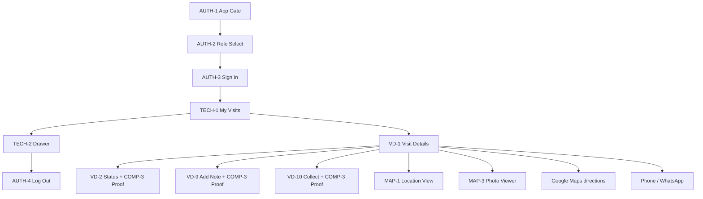
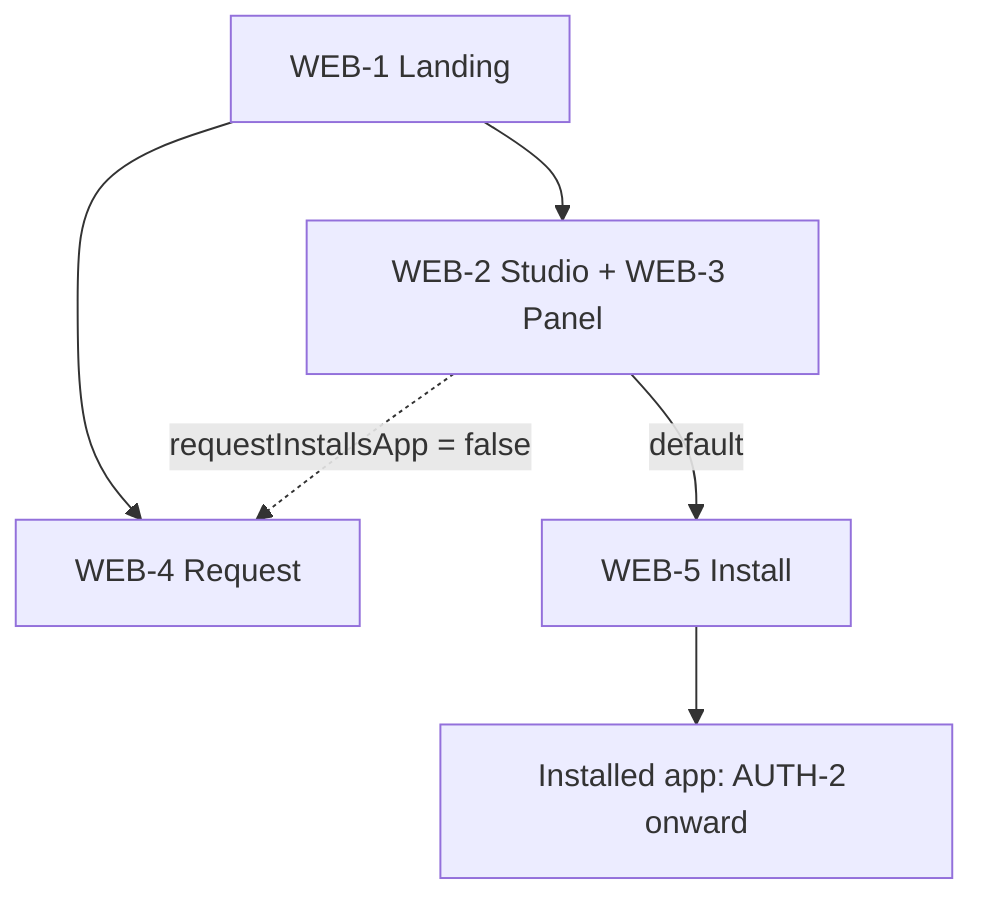

# Visit Proof: Screen and UX Specification

A complete inventory of the current product, written for the UI redesign. Everything here comes from reading the code as of 2026-11-07. Where the code does not settle something, the text says "unclear".

**How UI text is quoted:** `"English" / "العربية"`, exactly as written in the code and `lib/configs/app_translations.dart`. If only English appears, the string has no Arabic entry and shows in English on the Arabic app. `{0}`, `{1}` are values inserted at runtime.

**Important context for the designer:**
- There is no server. All data lives on one device, so admin and technician only share data on the same device.
- There are no push notifications and no live updates anywhere. Screens refresh on pull, on return, or after an action.
- The dashboard and dispatch map do **not** show technician positions. Location is captured only at the moment a technician performs an action.
- Screen IDs such as `VD-1` are this document's own labels, used for cross-references.

## 1. Overview

### Tech stack
| Area | What is used |
|---|---|
| Framework | Flutter 3.27.x, Dart `^3.6.2`, Material 3 widgets |
| State management | BLoC (`flutter_bloc`) with GetIt for dependency lookup |
| Architecture | Clean Architecture per feature: `data` / `domain` / `presentation` |
| Routing | Flutter `Navigator` with named routes in `lib/app/visit_proof_app.dart`; some screens are pushed directly with `MaterialPageRoute` |
| Backend | None. Each "remote data source" is a local prototype that stores JSON in `SharedPreferences` |
| Photos | Stored on the device; web keeps the picker path |
| Maps | `flutter_map` with OpenStreetMap tiles; place search via `photon.komoot.io`; reverse geocoding via `geocoding` |
| Location | `geolocator` (rejects mock locations) |
| Camera | `image_picker`, camera only for proof photos |
| Fonts | `google_fonts`: Manrope (English), Cairo (Arabic) |
| Localization | A custom `.tr` map in `app_translations.dart`, English and Arabic |

### Roles
| Role | How they enter | Can access |
|---|---|---|
| **Admin** | One tap on the role screen. No account or password | Everything: dashboard, dispatch, visits, invoices, collections, clients, technicians, services |
| **Technician** | Email and password set by the admin | Own visits only. Can move a visit forward (start trip, start work, complete), add notes, and collect payment, each with live location and, where needed, camera photos. Sees the invoice of own visits, read-only apart from collecting |
| **Website visitor** | Web build | Wizpo sales site and the design studio. Not an app role |

Either role can switch to the other from the drawer. Switching from technician to admin needs no password.

### Platforms
| Part | Targets |
|---|---|
| Visit Proof app | Android and iOS are the main targets. Also runs in a browser, and project folders exist for Windows, macOS and Linux |
| Layout | Phone-first. Only DSP-1 and DSH-1 change layout on wide screens (900 px and up); INV-3 limits its width to 680 px. All other screens stretch to full width |
| Website (Wizpo) | Web only. Shows the real app inside a phone frame |
| PWA | Two forms: an installable customer build (`CUSTOMER_APP=true`), and an app installed from the studio with the design carried in its link. Hosted on GitHub Pages |

## 2. Screen inventory

Platform key: **Mobile** = phone layout that stretches on desktop. **Both** = adapts to wide screens. **Web** = website only. **Sheet** and **dialog** follow their parent.

| # | Screen name | File path | Route | Role(s) | Platform | Purpose |
|---|---|---|---|---|---|---|
| AUTH-1 | App Gate | `lib/features/auth/presentation/screens/app_gate_scr.dart` | `/` | All | Mobile | Shows the right home for the session |
| AUTH-2 | Role Select | `lib/features/auth/presentation/screens/role_select_scr.dart` | `/RoleSelectScr` | All | Mobile | Choose admin or technician |
| AUTH-3 | Technician Sign In | `lib/features/auth/presentation/screens/tech_login_scr.dart` | `/TechLoginScr` | Technician | Mobile | Email and password sign in |
| AUTH-4 | Log Out Confirmation (dialog) | `lib/features/auth/presentation/widgets/auth_widget_account_actions.dart` | none | Admin, Technician | Mobile | Confirm logging out |
| ADM-1 | Admin Shell and Drawer | `lib/features/main_menu/presentation/screens/main_menu_scr.dart` | `/MainMenuScr` | Admin | Mobile | Side menu hosting eight sections |
| TECH-1 | Technician Home (My Visits) | `lib/features/technician_home/presentation/screens/tech_home_scr.dart` | `/TechHomeScr` | Technician | Mobile | Own visits and current job |
| TECH-2 | Technician Drawer | `lib/features/technician_home/presentation/widgets/tech_home_widget_drawer.dart` | none | Technician | Mobile | Profile, tips, settings, log out |
| COMP-1 | Settings Card | `lib/core/utils/general_widgets/g_widget_app_settings.dart` | none | Admin, Technician | Mobile | Language and dark mode |
| COMP-2 | PWA Install Bar and Dialog | `lib/core/utils/general_widgets/g_widget_install_banner.dart` | none | Admin, Technician | Mobile | Offers to install an opened design |
| VIS-1 | Visits List | `lib/features/visits/presentation/screens/visits_scr.dart` | none (drawer) | Admin | Mobile | Search and filter all visits |
| VIS-2 | Filter Visits (sheet) | `lib/features/visits/presentation/widgets/visits_widget_filter_sheet.dart` | none | Admin | Mobile | Filter by status, payment, priority |
| VIS-3 | Add Visit | `lib/features/add_visit/presentation/screens/add_visit_scr.dart` | `/AddVisitScr` | Admin | Mobile | Create a visit |
| VIS-4 | Add / Update Site (sheet) | `lib/features/add_visit/presentation/widgets/add_visit_widget_site_sheet.dart` | none | Admin | Mobile | Enter a site |
| VD-1 | Visit Details | `lib/features/visit_detail/presentation/screens/visit_detail_scr.dart` | `/VisitDetailScr` | Admin, Technician | Mobile | Everything about one visit |
| VD-2 | Change Visit Status (sheet) | `lib/features/visit_detail/presentation/widgets/sheets/visit_detail_widget_status_sheet.dart` | none | Admin, Technician | Mobile | Confirm a status move |
| VD-3 | Assign / Reassign Technician (sheet) | `.../sheets/visit_detail_widget_assign_sheet.dart` | none | Admin | Mobile | Choose a technician |
| VD-4 | Unassign Technician (sheet) | `.../sheets/visit_detail_widget_unassign_sheet.dart` | none | Admin | Mobile | Release the technician |
| VD-5 | Reschedule Visit (sheet) | `.../sheets/visit_detail_widget_reschedule_sheet.dart` | none | Admin | Mobile | Change date and time |
| VD-6 | Change Service (sheet) | `.../sheets/visit_detail_widget_service_sheet.dart` | none | Admin | Mobile | Swap the service |
| VD-7 | Change Site (sheet) | `.../sheets/visit_detail_widget_site_sheet.dart` | none | Admin | Mobile | Swap the site |
| VD-8 | Edit Job Notes (sheet) | `.../sheets/visit_detail_widget_info_sheet.dart` | none | Admin | Mobile | Priority, problem, notes, photo rules |
| VD-9 | Add a Note (sheet) | `.../sheets/visit_detail_widget_comment_sheet.dart` | none | Admin, Technician | Mobile | Add to the activity log |
| VD-10 | Collect Payment (sheet) | `.../sheets/visit_detail_widget_collect_sheet.dart` | none | Technician | Mobile | Record a field payment |
| VD-11 | Delete Visit Confirmation (dialog) | `lib/features/visit_detail/presentation/widgets/visit_detail_body.dart` | none | Admin | Mobile | Confirm deletion |
| COMP-3 | Field Proof Panel | `lib/features/visit_detail/presentation/widgets/visit_detail_widget_field_proof.dart` | none | Technician | Mobile | Location, consent and photos |
| DSP-1 | Dispatch Board | `lib/features/dispatch/presentation/screens/dispatch_scr.dart` | `/DispatchScr` | Admin | Both | Plan and assign the day |
| DSP-2 | Technician Card | `lib/features/dispatch/presentation/widgets/dispatch_widget_technician_card.dart` | none | Admin | Both | Workload and drop target |
| DSP-3 | Waiting Queue | `lib/features/dispatch/presentation/widgets/dispatch_widget_queue.dart` | none | Admin | Both | Visits with no technician |
| DSP-4 | Dispatch Map | `lib/features/dispatch/presentation/widgets/dispatch_widget_map.dart` | none | Admin | Both | Visit sites on a map |
| DSP-5 | Unassigned Tray | `lib/features/dispatch/presentation/widgets/dispatch_widget_unassigned_tray.dart` | none | Admin | Mobile | Docked drag source |
| DSP-6 | Assign Visit (sheet) | `lib/features/dispatch/presentation/widgets/sheets/dispatch_widget_assign_sheet.dart` | none | Admin | Both | Confirm assignment with rule check |
| DSP-7 | Visit Quick Sheet | `.../sheets/dispatch_widget_visit_sheet.dart` | none | Admin | Both | Summary and quick actions |
| DSP-8 | Bulk Assign (sheet) | `.../sheets/dispatch_widget_bulk_assign_sheet.dart` | none | Admin | Both | Assign many at once |
| DSP-9 | Suggested Technicians (sheet) | `.../sheets/dispatch_widget_suggest_sheet.dart` | none | Admin | Both | Ranked technician list |
| DSP-10 | Redistribute Visits (sheet) | `.../sheets/dispatch_widget_redistribute_sheet.dart` | none | Admin | Both | Move a technician's day |
| DSP-11 | Dispatch Rules (sheet) | `.../sheets/dispatch_widget_settings_sheet.dart` | none | Admin | Both | Working hours and limits |
| DSP-12 | Visit List (sheet) | `.../sheets/dispatch_widget_visit_list_sheet.dart` | none | Admin | Both | Visits behind a KPI |
| DSP-13 | Dispatch Visit Card | `lib/features/dispatch/presentation/widgets/dispatch_widget_visit_card.dart` | none | Admin | Both | Draggable visit card |
| DSP-14 | Unassign (board sheet) | `.../sheets/dispatch_widget_unassign_sheet.dart` | none | Admin | Both | Release the technician |
| DSP-15 | Reschedule (board sheet) | `.../sheets/dispatch_widget_reschedule_sheet.dart` | none | Admin | Both | Move with rule check |
| DSP-16 | Update Status (board sheet) | `.../sheets/dispatch_widget_status_sheet.dart` | none | Admin | Both | Change status from the board |
| DSH-1 | Dashboard | `lib/features/dashboard/presentation/screens/dashboard_scr.dart` | `/DashboardScr` | Admin | Both | Operations overview |
| DSH-2 | Dashboard Insight (four modes) | `lib/features/dashboard/presentation/screens/dashboard_insight_scr.dart` | none | Admin | Mobile | Drill-down reports |
| DSH-3 | Technician Results | `lib/features/dashboard/presentation/screens/dashboard_technician_scr.dart` | none | Admin | Mobile | One technician's numbers |
| INV-1 | Invoices List | `lib/features/invoices/presentation/screens/invoices_scr.dart` | none (drawer) | Admin | Mobile | Search and filter invoices |
| INV-2 | Filter Invoices (sheet) | `lib/features/invoices/presentation/widgets/invoices_widgets/invoices_widget_filter_sheet.dart` | none | Admin | Mobile | Filter by stage and payment |
| INV-3 | Invoice Details | `lib/features/invoices/presentation/screens/invoice_detail_scr.dart` | `/InvoiceDetailScr` | Admin | Both | Amounts, payments, actions |
| INV-4 | Collections | `lib/features/invoices/presentation/screens/collections_scr.dart` | none (drawer) | Admin | Mobile | Review field payments |
| COMP-4 | Payment Tile | `lib/features/invoices/presentation/widgets/payments_widgets/payments_widget_tile.dart` | none | Admin | Mobile | One ledger entry |
| INV-5 | Record a Payment (sheet) | `.../invoice_detail_widget/inv_detail_widget_record_payment_sheet.dart` | none | Admin | Mobile | Record a payment |
| INV-6 | Edit Draft Invoice (sheet) | `.../invoice_detail_widget/inv_detail_widget_edit_sheet.dart` | none | Admin | Mobile | Discount, tax, notes |
| INV-7 | Refund Payment (sheet) | `.../invoice_detail_widget/inv_detail_widget_refund_payment_sheet.dart` | none | Admin | Mobile | Refund |
| INV-8 | Issue Invoice (dialog) | `.../invoice_detail_widget/invoice_detail_body.dart` | none | Admin | Mobile | Confirm issuing |
| INV-9 | Confirm Collection (dialog) | `.../payments_widgets/payments_widget_review.dart` | none | Admin | Mobile | Approve a field payment |
| INV-10 | Reject Collection (dialog) | `.../payments_widgets/payments_widget_review.dart` | none | Admin | Mobile | Reject with a reason |
| CLI-1 | Clients List | `lib/features/clients/presentation/screens/clients_scr.dart` | `/ClientsScr` | Admin | Mobile | Search clients |
| CLI-2 | Client Details | `lib/features/clients/presentation/screens/client_detail_scr.dart` | `/ClientDetailScr` | Admin | Mobile | Profile, equipment, visits |
| CLI-3 | Add / Edit Client | `lib/features/clients/presentation/screens/add_client_scr.dart` | `/AddClientScr` | Admin | Mobile | Client form |
| CLI-4 | Add New Equipment (dialog) | `lib/features/clients/presentation/widgets/client_detail_widgets/client_detail_widget_equipments.dart` | none | Admin | Mobile | Add equipment |
| COMP-5 | Delete Confirmation (dialog) | `lib/configs/app_toasts.dart` | none | Admin | Mobile | Generic delete confirm |
| COMP-6 | Map + Address Block | `lib/features/clients/presentation/widgets/add_client_widgets/add_client_widget_location.dart` | none | Admin | Mobile | Pin preview and address field |
| TEC-1 | Technicians List | `lib/features/technicians/presentation/screens/technicians_scr.dart` | none (drawer) | Admin | Mobile | Search technicians |
| TEC-2 | Technician Detail | `lib/features/technicians/presentation/screens/technician_detail_scr.dart` | `/TechnicianDetailScr` | Admin | Mobile | Profile and visit history |
| TEC-3 | Add / Edit Technician | `lib/features/technicians/presentation/screens/add_tech_scr.dart` | `/AddTechScr` | Admin | Mobile | Technician form |
| SVC-1 | Services List | `lib/features/services/presentation/screens/services_scr.dart` | none (drawer) | Admin | Mobile | Search services |
| SVC-2 | Create / Update Service (sheet) | `lib/features/services/presentation/screens/add_service_scr.dart` | none | Admin | Mobile | Service form |
| MAP-1 | Location View | `lib/core/utils/general_widgets/g_widget_location_view_scr.dart` | none | Admin, Technician | Mobile | View one point |
| MAP-2 | Location Picker | `lib/core/utils/general_widgets/g_widget_location_picker_scr.dart` | none | Admin | Mobile | Pick a site on a map |
| MAP-3 | Photo Viewer | `lib/core/utils/general_widgets/g_widget_photo_viewer.dart` | none | Admin, Technician | Mobile | Full-screen swipe and zoom |
| SYS-1 | Date, Time and Range Pickers | `lib/core/utils/general_functions.dart/g_fun_date_pick.dart` | none | Admin | Mobile | System pickers |
| SYS-2 | Country Picker | `lib/core/utils/general_widgets/g_widget_phone_field.dart` | none | Admin | Mobile | Phone country code |
| WEB-1 | Wizpo Landing Page | `lib/features/website/presentation/screens/website_scr.dart` | web only | Visitor | Web | Sales page |
| WEB-2 | Design Studio (Live Demo) | `lib/features/website/presentation/screens/website_studio_scr.dart` | web only | Visitor | Web | Try and restyle the app |
| WEB-3 | Design Panel | `lib/features/website/presentation/widgets/studio_widget_panel.dart` | none | Visitor | Web | Design controls |
| WEB-4 | Request Your Version | `lib/features/website/presentation/screens/website_request_scr.dart` | web only | Visitor | Web | Request form |
| WEB-5 | Install Dialogs | `lib/features/website/presentation/widgets/studio_widget_install.dart` | none | Visitor | Web | Install result or steps |

`.../sheets/` and `.../payments_widgets/` continue the feature's path shown in the rows above them.

## 3. Per-screen specification

### AUTH-1 · App Gate
- **Role / entry points:** Everyone. It is route `/`, the first thing `VisitProofApp` shows. Switching role or logging out pops back to it.
- **Layout, top to bottom:** No UI of its own. It swaps its whole content for one of three screens.
- **Data shown:** None directly. Reads `AppSession.current`.
- **Inputs & forms:** None.
- **Actions:** Automatic: technician session → TECH-1; admin session → ADM-1; no session → AUTH-2.
- **States:** Follows the session live, so changing session changes the screen with no navigation step.
- **Conditional UI:** Entirely session-driven.
- **Notifications / real-time behavior:** Listens to the local session value only.
- **Notes:** In web builds the app runs inside the studio phone frame or an installed PWA, not on the website itself.

### AUTH-2 · Role Select
- **Role / entry points:** No session yet. Shown by AUTH-1, also registered as `/RoleSelectScr`.
- **Layout, top to bottom:** Plain scrolling page with no app bar: brand block (gradient rounded tile with the brand mark, app name, tagline) → heading → hint → Admin card → Technician card → settings card (language and dark mode).
- **Data shown:** `AppBrand.appName` (default "Visit Proof" / "Visit Proof"), "Field visits with proof of work" / "زيارات ميدانية مع إثبات العمل", "How do you want to continue?" / "كيف تريد المتابعة؟", "You can switch roles later from the app menu." / "يمكنك تغيير الدور لاحقًا من قائمة التطبيق."
- **Inputs & forms:** None here; the settings card is covered in COMP-1.
- **Actions:** Admin card ("Admin" / "المسؤول" / "Plan visits, dispatch technicians and follow invoices." / "خطط الزيارات ووزّع الفنيين وتابع الفواتير.") → starts an admin session with no password, then AUTH-1 shows ADM-1. Technician card ("Technician" / "الفني" / "See your visits, check in on site and add proof photos." / "اطّلع على زياراتك وسجّل وصولك للموقع وأضف صور الإثبات.") → AUTH-3.
- **States:** Admin card shows a small spinner and is disabled while entering. There are no empty or error states designed.
- **Conditional UI:** Settings card hidden if both language and dark mode switches are turned off for the build. In an installed PWA the dark-mode row is hidden.
- **Notifications / real-time behavior:** None.
- **Notes:** Anyone can enter as Admin; there is no admin account or password.

### AUTH-3 · Technician Sign In
- **Role / entry points:** Technician. From AUTH-2, or "Switch to technician" / "التبديل إلى فني" in the admin drawer. Route `/TechLoginScr`.
- **Layout, top to bottom:** Back-arrow header "Technician sign in" / "تسجيل دخول الفني" → large engineer icon → "Welcome back" / "مرحبًا بعودتك" → "Use the email and password your admin created for you." / "استخدم البريد الإلكتروني وكلمة المرور اللذين أنشأهما لك المسؤول." → email field → password field → "Sign in" / "تسجيل الدخول" button → "Forgot your password? Ask your admin to set a new one." / "نسيت كلمة المرور؟ اطلب من المسؤول تعيين كلمة جديدة."
- **Data shown:** Static text only.
- **Inputs & forms:**
  - Email: text, label "Email Address" / "البريد الإلكتروني", placeholder "name@company.com" (not translated), required, must be a valid email, else "Please enter a valid email address" / "يرجى إدخال بريد إلكتروني صحيح". Prefix `@` icon.
  - Password: obscured, label "Password" / "كلمة المرور", no placeholder, required, else "Please enter your password" / "يرجى إدخال كلمة المرور". Eye icon toggles visibility. Enter key submits.
- **Actions:** "Sign in" / "تسجيل الدخول" → validates, then signs in. On success returns to the root and AUTH-1 shows TECH-1, with toast "Welcome, {0}" / "أهلًا، {0}".
- **States:** Button spinner while loading. Server-style failures appear as a red toast (see section 6 for messages).
- **Conditional UI:** None.
- **Notifications / real-time behavior:** None.
- **Notes:** No "forgot password" flow; the text only tells the user to ask the admin.

### AUTH-4 · Log Out Confirmation (dialog)
- **Role / entry points:** Admin and technician, from "Log out" / "تسجيل الخروج" in either drawer.
- **Layout, top to bottom:** Centered dialog: red logout icon → "Log out?" / "تسجيل الخروج؟" → "You will need to sign in again to use the app." / "ستحتاج إلى تسجيل الدخول مرة أخرى لاستخدام التطبيق." → "Cancel" / "إلغاء" and "Log out" / "تسجيل الخروج" buttons.
- **Data shown:** Static.
- **Inputs & forms:** None.
- **Actions:** "Cancel" / "إلغاء" closes. "Log out" / "تسجيل الخروج" clears the session and returns to the root, which shows AUTH-2.
- **States:** The drawer tile shows a spinner while logging out.
- **Conditional UI:** None.
- **Notifications / real-time behavior:** None.
- **Notes:** The wording says "sign in again", but an admin has nothing to sign in with.

### ADM-1 · Admin Shell and Drawer
- **Role / entry points:** Admin. Shown by AUTH-1, also `/MainMenuScr`. Hosts eight sections in one `Scaffold` with a side drawer. There is no bottom navigation.
- **Layout, top to bottom (drawer):** Gradient header with rounded corner (brand mark, app name, "Admin" / "المسؤول") → scrolling groups → footer: settings card → "Switch to technician" / "التبديل إلى فني" → "Log out" / "تسجيل الخروج".
  - "Operations" / "العمليات": "Dashboard" / "لوحة التحكم" ("Overview and what needs attention" / "نظرة عامة وما يحتاج إلى متابعة"), "Dispatch" / "التوزيع" ("Assign and schedule technicians" / "إسناد الفنيين وجدولتهم"), "Visits" / "الزيارات" ("Every visit and its status" / "كل الزيارات وحالاتها")
  - "Finance" / "المالية": "Invoices" / "الفواتير" ("Billing, payments and refunds" / "الفواتير والمدفوعات والاستردادات"), "Collections" / "التحصيلات" ("Field payments to confirm" / "مدفوعات ميدانية بانتظار التأكيد")
  - "Directory" / "الدليل": "Clients" / "العملاء" ("Customers, sites and equipment" / "العملاء والمواقع والمعدات"), "Technicians" / "الفنيون" ("Your field team" / "فريقك الميداني"), "Services" / "الخدمات" ("Prices, durations and checklists" / "الأسعار والمدد وقوائم التحقق")
- **Data shown:** Group labels are uppercased. Each row has an icon tile, label and hint.
- **Inputs & forms:** None beyond COMP-1.
- **Actions:** Row → closes the drawer and swaps the section (always a fresh rebuild, so scroll and filters reset). "Switch to technician" / "التبديل إلى فني" → AUTH-3. "Log out" / "تسجيل الخروج" → AUTH-4. The drawer opens from each section's menu button.
- **States:** Selected row has a tinted background, a filled icon tile and the filled icon variant.
- **Conditional UI:** Android back on any section other than Dashboard returns to Dashboard instead of exiting.
- **Notifications / real-time behavior:** No badges or counts on menu items.
- **Notes:** Collections has no count badge even though it is a queue of items waiting for action.

### TECH-1 · Technician Home (My Visits)
- **Role / entry points:** Technician. Shown by AUTH-1 after sign in; also `/TechHomeScr`.
- **Layout, top to bottom:** App bar "My Visits" / "زياراتي" with menu button → gradient greeting card → active job card (optional) → filter chips → visit cards. Pull to refresh.
- **Data shown:**
  - Greeting: "Hi, {0}" / "مرحبًا، {0}" from `AppSession.technicianName`; today as `EEEE, dd MMM yyyy`; open count with "open visits" / "زيارات مفتوحة".
  - Active job: first visit in "On The Way" / "في الطريق" or "In Progress" / "قيد التنفيذ". "Current job · {0}" / "المهمة الحالية · {0}", then service name · client name.
  - Filter chips: "{0} ({1})" / "{0} ({1})" for "Open" / "مفتوحة", "Today" / "اليوم", "Completed" / "مكتملة", "All" / "الكل". Open means assigned, on the way or in progress.
  - Cards: same card as VIS-1, filtered to this technician in the data source.
  - Sort: Open and Today ascending by start date; Completed and All descending.
- **Inputs & forms:** None. Default filter is "Open" / "مفتوحة".
- **Actions:** Card or active job → VD-1, refreshes on return. Chip → filters locally. Menu → TECH-2.
- **States:**
  - Loading: `GWidgetLoading` overlay.
  - Empty (none assigned): "No visits assigned to you yet" / "لا توجد زيارات مسندة إليك بعد" / "Your admin assigns visits to you. Pull down to refresh." / "يسند إليك المسؤول الزيارات. اسحب للأسفل للتحديث."
  - Empty (filter): "Nothing in this list" / "لا يوجد شيء في هذه القائمة" / "Try another filter." / "جرّب عامل تصفية آخر."
  - Error: toast only, no error screen.
- **Conditional UI:** Active job card only when one exists.
- **Notifications / real-time behavior:** None. A new assignment appears only after pull to refresh or reopening.
- **Notes:** No map or route view for the day. Nothing marks a visit as late on this screen.

### TECH-2 · Technician Drawer
- **Role / entry points:** Technician, from TECH-1's menu button.
- **Layout, top to bottom:** Gradient header (initial avatar, name, email) → two tip cards → footer: settings card → "Switch to admin" / "التبديل إلى المسؤول" → "Log out" / "تسجيل الخروج".
- **Data shown:** `technicianName` (fallback "Technician" / "الفني"), `technicianEmail`. Tips: "Every action you take records your current location for the admin." / "كل إجراء تقوم به يسجّل موقعك الحالي ليراه المسؤول." and "Take before and after photos when the visit asks for them." / "التقط صور ما قبل العمل وما بعده عندما تطلبها الزيارة."
- **Inputs & forms:** COMP-1 only.
- **Actions:** "Switch to admin" / "التبديل إلى المسؤول" → enters admin with no password. "Log out" / "تسجيل الخروج" → AUTH-4.
- **States:** Spinner on the tile while switching.
- **Conditional UI:** Settings card hidden if no switch is available.
- **Notifications / real-time behavior:** None.
- **Notes:** A technician can become admin with one tap, because admin has no credentials. This must change before real use.

### COMP-1 · Settings Card (language and dark mode)
- **Role / entry points:** Embedded in AUTH-2, the admin drawer and the technician drawer.
- **Layout, top to bottom:** Rounded card with a "Language" / "اللغة" row (two-part toggle: "English" / "العربية", each written in its own language) and, below a divider, a dark-mode row with a switch.
- **Data shown:** Current language and mode.
- **Inputs & forms:** Toggle and switch. Defaults: `AppTheme.darkModeByDefault` is false; language from `AppLanguage`.
- **Actions:** Language changes text, date locale and direction at once, and saves. Dark switch restyles and saves.
- **States:** Selected language segment is filled with the primary color.
- **Conditional UI:** Dark row hidden in a PWA installed from the studio (theme is locked).
- **Notifications / real-time behavior:** Applies instantly.
- **Notes:** None.

### COMP-2 · PWA Install Bar and Dialog
- **Role / entry points:** Anyone who opens a studio-designed app's link (`#app=…`) in a browser tab instead of from its icon.
- **Layout, top to bottom:** Solid primary bar above the whole app: icon → text → "Install" / "تثبيت" → close X. Falls back to a small dialog.
- **Data shown:** "Install this app on your device." / "ثبّت هذا التطبيق على جهازك." On iPhone/iPad: "To install, tap Share and then "Add to Home Screen"." / "للتثبيت، اضغط على زر المشاركة ثم اختر «إضافة إلى الشاشة الرئيسية»." with no button.
- **Inputs & forms:** None.
- **Actions:** "Install" / "تثبيت" → browser install prompt. If the browser cannot prompt: dialog "Install {0}" / "تثبيت {0}" / "Open your browser menu and choose "Install app" or "Add to Home Screen"." / "افتح قائمة المتصفح واختر «تثبيت التطبيق» أو «إضافة إلى الشاشة الرئيسية»." / "OK" / "حسنًا". X ("Close" / "إغلاق") hides the bar until reload.
- **States:** Disappears once installed.
- **Conditional UI:** Hidden when running standalone.
- **Notifications / real-time behavior:** None.
- **Notes:** Not part of normal app use; it exists for the current demo install flow.

### VIS-1 · Visits List
- **Role / entry points:** Admin, "Visits" / "الزيارات" drawer section. No route of its own.
- **Layout, top to bottom:** App bar "Visits" / "الزيارات" with menu button and a gradient "Dispatch" / "التوزيع" button → search field + filter button → visit cards → floating "Add New Visit" / "إضافة زيارة جديدة" button. Pull to refresh.
- **Data shown (card):**
  - `visitNumber` (fallback "#VISIT-000"), date `dd MMM yyyy · hh:mm a` (fallback "No date" / "بدون تاريخ"), status chip (uppercased, status color).
  - Client name ("no client" / "بدون عميل"), category ("no category" / "بدون فئة"), technician ("no technician assigned" / "لم يُسند فني").
  - City - address ("Unknown" / "غير معروف" for the city).
  - Problem description, when present.
  - Priority chip and payment chip (small, uppercased). Chevron.
- **Inputs & forms:** Search "Search visit number, client, service..." / "ابحث برقم الزيارة أو العميل أو الخدمة...": matches number, service, category, client name and phone, technician, city and address. Filters: VIS-2.
- **Actions:** Card → VD-1, then refresh. "Dispatch" / "التوزيع" → DSP-1 section. FAB → VIS-3, refresh if a visit was created. Filter button → VIS-2.
- **States:**
  - Loading: `GWidgetLoading`.
  - Empty: "No visits yet" / "لا توجد زيارات بعد" / "Create your first visit to start tracking field work." / "أنشئ أول زيارة لتبدأ متابعة العمل الميداني." / "Add first visit" / "أضف أول زيارة"
  - No match: "No matching visits" / "لا توجد زيارات مطابقة" / "Try another search or clear the filters." / "جرّب بحثًا آخر أو امسح التصفية." / "Clear search & filters" / "مسح البحث والتصفية"
  - Error: toast only.
  - Business: status, priority and payment chips.
- **Conditional UI:** Filter button shows the active filter count. Problem line only when set.
- **Notifications / real-time behavior:** None.
- **Notes:** No pagination; all visits load at once. Order is whatever the data source returns.

### VIS-2 · Filter Visits (sheet)
- **Role / entry points:** Admin, from VIS-1's filter button.
- **Layout, top to bottom:** Sheet header "Filter visits" / "تصفية الزيارات" / "Pick one or more options in each group" / "اختر خيارًا أو أكثر في كل مجموعة" → "Visit status" / "حالة الزيارة" chips → "Payment" / "الدفع" chips → "Priority" / "الأولوية" chips → "Reset" / "إعادة ضبط" and "Apply" / "تطبيق".
- **Data shown:** All values of `VisitStatus`, `PaymentStatus`, `Priority`.
- **Inputs & forms:** Multi-select chips. All optional. Default none.
- **Actions:** Chip toggles. "Reset" / "إعادة ضبط" closes with empty filters. "Apply" / "تطبيق" closes with the selection. Within a group, options are OR; between groups, AND.
- **States:** Selected chip styling.
- **Conditional UI:** None.
- **Notifications / real-time behavior:** None.
- **Notes:** No date-range filter and no technician filter.

### VIS-3 · Add Visit
- **Role / entry points:** Admin. From VIS-1, the Dashboard and DSP-1; pops `true` on success. Route `/AddVisitScr`.
- **Layout, top to bottom:** Back header "Add Visit" / "إضافة زيارة" → three titled cards → frosted sticky footer.
  1. "Client & Site" / "العميل والموقع": client dropdown → "Add New Client" / "إضافة عميل جديد" → (once a client is chosen) site dropdown + "Update\nSite" / "تحديث\nالموقع" (when a site is chosen) → "Add New Site" / "إضافة موقع جديد".
  2. "Service" / "الخدمة": service dropdown → "Add New Service" / "إضافة خدمة جديدة" → summary card → two photo switches.
  3. "Scheduling & Assignment" / "الجدولة والإسناد": technician dropdown → "Add New Technician" / "إضافة فني جديد" → priority → start date → start time → problem → notes.
  - Footer: "Save Draft" / "حفظ كمسودة" and "Schedule" / "جدولة" (reads "Assigned" / "مُسندة" when a technician is chosen), then tip "Tip: Since you've already chosen a technician, the 'Schedule' button has updated to 'Assigned'" / "تلميح: بما أنك اخترت فنيًا، تغيّر زر "جدولة" إلى "مُسندة""
- **Data shown:** Service summary: category chip ("Uncategorized" / "بدون فئة"), price `0.00 SAR` (only if above 0), name ("Unnamed Service" / "خدمة بدون اسم"), checklist, "{0} Min" / "{0} دقيقة", "{0} Task{1}" / "{0} مهام", "Update" / "تحديث".
- **Inputs & forms:**
  - Client: searchable dropdown, label "Client" / "العميل", search hint "Search for client" / "ابحث عن عميل". Required to schedule.
  - Site: dropdown, label "Site" / "الموقع", items `City - address`. Required to schedule.
  - Service: searchable dropdown, label "Service" / "الخدمة"; each item shows name + category. Required to schedule.
  - "Require Before-Work Photos" / "طلب صور ما قبل العمل" / "Require After-Work Photos" / "طلب صور ما بعد العمل": switches, subtitle "Technician supplies proof during the visit" / "يقدّم الفني الإثبات أثناء الزيارة", default off.
  - Technician: searchable dropdown, label "Technician" / "الفني", search hint "Search for an technician" / "ابحث عن فني". Optional.
  - Priority: dropdown, label "Priority" / "الأولوية", default normal.
  - Start date: tap-to-pick, label "Start Date" / "تاريخ البدء", placeholder "dd MMM yyy", today to +365 days, opens on tomorrow. Required to schedule.
  - Start time: tap-to-pick, label "Start Time" / "وقت البدء", placeholder "00:00 AM/PM" / "00:00 ص/م". Required to schedule; must be in the future, else "Start time must be in the future" / "يجب أن يكون وقت البدء في المستقبل".
  - Problem: text, label "Problem" / "المشكلة", max 1000, placeholder "e.g., AC unit in the master bedroom is blowing warm air. The outdoor compressor is making a loud buzzing noise...." / "مثال: مكيف غرفة النوم الرئيسية يخرج هواءً ساخنًا، والضاغط الخارجي يصدر صوتًا عاليًا...."
  - Notes: text, label "Notes" / "ملاحظات", max 250, placeholder "e.g., Gate code is 1234, call 10 mins before arrival..." / "مثال: رمز البوابة 1234، اتصل قبل الوصول بـ10 دقائق..."
  - Missing required field: "This field is required to {0}" / "هذا الحقل مطلوب لـ{0}", with the button's name inserted. The page scrolls to the first section with an error.
- **Actions:** "Add New Client" / "إضافة عميل جديد" → CLI-3 (returns the client and selects it). "Add New Site" / "إضافة موقع جديد" / "Update\nSite" / "تحديث\nالموقع" → VIS-4. "Add New Service" / "إضافة خدمة جديدة" / "Update" / "تحديث" → SVC-2. "Add New Technician" / "إضافة فني جديد" → TEC-3. "Save Draft" / "حفظ كمسودة" → saves with no screen validation. "Schedule" / "جدولة" / "Assigned" / "مُسندة" → validates, then saves as scheduled or assigned.
- **States:** Dropdown spinners while lists load. Spinner on the pressed footer button. Save failures show a toast and stay on the screen.
- **Conditional UI:** Site controls appear after a client is chosen. Footer gets an amber tint and the tip when a technician is chosen.
- **Notifications / real-time behavior:** None; lists are read once.
- **Notes:** The service dropdown reuses the hint "Search for client" / "ابحث عن عميل". "Search for an technician" is a typo. The button label "Assigned" / "مُسندة" is a status word, not a verb. A price is not editable here; it comes from the service. Technician availability is only checked at save.

### VIS-4 · Add / Update Site (sheet)
- **Role / entry points:** Admin. From VIS-3 and VD-7.
- **Layout, top to bottom:** Sheet title "Add new site" / "إضافة موقع جديد" or "Update Site" / "تحديث الموقع" → city dropdown → "Address Configuration" / "إعداد العنوان" → location block (COMP-3) → submit button.
- **Data shown:** Existing site values when updating.
- **Inputs & forms:**
  - City: searchable dropdown of Saudi cities, label "Select City *" / "اختر المدينة *", required, else "City is required" / "المدينة مطلوبة".
  - Address / map pin: at least one is needed, else "Please provide an address detail or pick a location from the map." / "يرجى إدخال تفاصيل العنوان أو تحديد الموقع على الخريطة." With no pin, the address must be at least 10 characters, else "Detailed address must be at least 10 characters long" / "يجب ألا يقل العنوان التفصيلي عن 10 أحرف".
- **Actions:** Submit ("Add new Site" / "إضافة موقع جديد" / "Update Site" / "تحديث الموقع") returns the site to the caller. Map pick → MAP-2.
- **States:** Inline errors.
- **Conditional UI:** Title and button text depend on add or update.
- **Notifications / real-time behavior:** None.
- **Notes:** The site is only held by the screen that opened it until that screen saves.

### VD-1 · Visit Details
- **Role / entry points:** Admin and technician. From visit cards, the Dashboard, Dispatch, client and technician pages. Route `/VisitDetailScr`, argument `visitID`.
- **Layout, top to bottom:** Back header "Visit Details" / "تفاصيل الزيارة" → scrolling cards, each with a colored top strip, icon and title. Pull to refresh.
  1. **Hero** (gradient; red when cancelled): visit number chip, status pill, service name ("No service selected" / "لم يتم اختيار خدمة"), category, three stats ("Price" / "السعر", "Priority" / "الأولوية", "Payment" / "الدفع"), then a six-step tracker ("Draft" / "مسودة", "Scheduled" / "مجدولة", "Assigned" / "مُسندة", "On way" / "في الطريق", "Work" / "العمل", "Done" / "تم") or the banner "This visit was cancelled and is out of the workflow." / "تم إلغاء هذه الزيارة وهي خارج مراحل العمل."
  2. **"Next Step" / "الخطوة التالية"**: status icon, "Currently {0}" / "حاليًا {0}", a hint for the role, action buttons.
  3. **"Client & Site" / "العميل والموقع"**: avatar, name, email, phone, "Call" / "اتصال", "WhatsApp" / "واتساب", site box with "Map" / "الخريطة" and "Directions" / "الاتجاهات". Header action "Change site" / "تغيير الموقع".
  4. **"Schedule & Technician" / "الموعد والفني"**: "Date" / "التاريخ", "Starts" / "يبدأ", "Duration" / "المدة" tiles, "Expected to finish around {0}" / "متوقع الانتهاء حوالي {0}", technician card ("{0} open jobs" / "{0} مهام مفتوحة", status pill, "Call" / "اتصال", "Reassign" / "إعادة إسناد", "Unassign" / "إلغاء الإسناد"). Header action "Reschedule" / "إعادة جدولة".
  5. **"Service" / "الخدمة"**: name, category pill, price, "Checklist · {0} tasks" / "قائمة المهام · {0} مهام" with task list, photo requirement pills. Header action "Change" / "تغيير".
  6. **"Job Notes" / "ملاحظات العمل"**: priority pill, "Problem" / "المشكلة", "Notes for the technician" / "ملاحظات للفني" (empty: "Nothing added yet" / "لم يُضف شيء بعد"). Header action "Edit" / "تعديل".
  7. **"Proof Photos" / "صور الإثبات"** (conditional): groups by kind with counts, required pills, thumbnails.
  8. **"Invoice" / "الفاتورة"** (conditional): number, issued pill, payment pill, balance card, pending notice, due date notice, "Collect payment" / "تحصيل الدفعة" or "Open invoice" / "فتح الفاتورة".
  9. **"Activity" / "النشاط"**: timeline, newest first, 5 shown, "Show all ({0})" / "عرض الكل ({0})" / "Show less" / "عرض أقل". Header action "Add note" / "إضافة ملاحظة".
  10. "Delete visit" / "حذف الزيارة" (conditional).
- **Data shown:**
  - Money `0.00 SAR`; dates `dd MMM yyyy`; times `hh:mm a`; duration "{0} h {1} min" / "{0} س {1} د", "{0} h" / "{0} س" or "{0} min" / "{0} دقيقة"; missing values "—".
  - Invoice balance: "Remaining balance" / "الرصيد المتبقي" or "Amount paid" / "المبلغ المدفوع" with a progress bar, "Paid {0}" / "المدفوع {0}", "Total {0}" / "الإجمالي {0}". Issued pill "Issued {0}" / "صدرت {0}" or "Draft" / "مسودة".
  - Activity row: description, date · actor · role, optional location chip ("Technician location · {0} from site" / "موقع الفني · على بُعد {0} من الموقع" or "Technician location · site has no map pin" / "موقع الفني · الموقع بلا إحداثيات على الخريطة"), optional quoted reason.
- **Inputs & forms:** None on the page; everything opens a sheet.
- **Actions:**
  - Next Step buttons → VD-2. Labels: "Schedule visit" / "جدولة الزيارة", "Back to draft" / "العودة إلى مسودة", "Reopen as draft" / "إعادة فتح كمسودة", "Back to assigned" / "العودة إلى مُسندة", "Start trip" / "بدء التنقل", "Start work" / "بدء العمل", "Complete visit" / "إكمال الزيارة". Separate text button "Cancel visit" / "إلغاء الزيارة".
  - "Assign technician" / "إسناد فني" / "Reassign" / "إعادة إسناد" → VD-3. "Unassign" / "إلغاء الإسناد" → VD-4. "Reschedule" / "إعادة جدولة" → VD-5. "Change" / "تغيير" → VD-6. "Change site" / "تغيير الموقع" → VD-7. "Edit" / "تعديل" → VD-8. "Add note" / "إضافة ملاحظة" → VD-9. "Collect payment" / "تحصيل الدفعة" → VD-10. "Delete visit" / "حذف الزيارة" → VD-11.
  - "Open invoice" / "فتح الفاتورة" → INV-3. "Call" / "اتصال" → phone dialer. "WhatsApp" / "واتساب" → WhatsApp. "Map" / "الخريطة" → MAP-1. "Directions" / "الاتجاهات" → Google Maps. Photo → MAP-3 viewer. Location chip → MAP-1.
- **States:**
  - Loading: spinner in the first load; overlay on refresh.
  - Error: "We could not load this visit" / "تعذّر تحميل هذه الزيارة" / "Try again" / "حاول مرة أخرى".
  - Empty blocks: "No client selected" / "لم يتم اختيار عميل", "No site selected" / "لم يتم اختيار موقع", "No technician assigned yet" / "لم يتم إسناد فني بعد", "No technician was assigned to this visit." / "لم يُسند فني لهذه الزيارة.", "No checklist tasks" / "لا توجد مهام", "No activity yet" / "لا يوجد نشاط بعد", "No invoice is linked to this visit" / "لا توجد فاتورة مرتبطة بهذه الزيارة", "Not taken yet" / "لم تُلتقط بعد".
  - Business: "Draft" / "مسودة", "Scheduled" / "مجدولة", "Assigned" / "مُسندة", "On The Way" / "في الطريق", "In Progress" / "قيد التنفيذ", "Completed" / "مكتملة", "Cancelled" / "ملغاة". Invoice: "Overdue since {0}" / "متأخرة منذ {0}" / "Due by {0}" / "مستحقة بحلول {0}", "{0} collected on site is awaiting admin confirmation" / "{0} محصّلة في الموقع بانتظار تأكيد المسؤول".
  - Hints by status for admin: "Complete the visit info, then schedule it." / "أكمل بيانات الزيارة ثم قم بجدولتها.", "Assign a technician to dispatch this visit." / "أسند فنيًا لإرسال هذه الزيارة.", "Waiting for the technician to start the trip." / "بانتظار بدء الفني للتنقل.", "The technician is heading to the site." / "الفني في طريقه إلى الموقع.", "Work is in progress at the site." / "العمل جارٍ في الموقع.", "Visit done. The invoice is issued; confirm the collection or record the payment." / "اكتملت الزيارة وصدرت الفاتورة؛ أكّد التحصيل أو سجّل الدفعة.", "This visit is cancelled. Reopen it to plan it again." / "هذه الزيارة ملغاة. أعد فتحها لتخطيطها من جديد."
  - Hints for technician: "The admin is still planning this visit." / "لا يزال المسؤول يخطط لهذه الزيارة.", "Start the trip when you leave for the site." / "ابدأ الرحلة عند انطلاقك إلى الموقع.", "Start work once you arrive. You must be within {0} of the site." / "ابدأ العمل عند وصولك. يجب أن تكون على بُعد {0} من الموقع أو أقل.", "Finish the work, take the after photos and complete the visit." / "أنهِ العمل والتقط صور ما بعد العمل ثم أكمل الزيارة.", "Well done. Collect the payment from the client if they pay now." / "أحسنت. حصّل الدفعة من العميل إذا كان سيدفع الآن.", "The admin cancelled this visit." / "ألغى المسؤول هذه الزيارة."
  - End of workflow: "This visit has reached the end of its workflow." / "وصلت هذه الزيارة إلى نهاية مراحلها."
- **Conditional UI:** Rules are in `VisitRules` (see section 6).
  - Header actions appear only if allowed: reschedule, change site and photo requirements before dispatch; edit notes until closed; change service only before dispatch with an untouched invoice.
  - "Assign technician" / "إسناد فني" shows in Next Step when the admin can assign and none is set.
  - Proof Photos shows if any photo exists or any are required.
  - Invoice shows to the admin always, and to a technician on their own visit.
  - "Collect payment" / "تحصيل الدفعة": technician, own visit, in progress or completed, invoice issued, unpaid/partial/pending, and something left to collect.
  - Otherwise the technician sees "The invoice is issued when the visit is completed. You can collect payment then." / "تصدر الفاتورة عند اكتمال الزيارة، ويمكنك تحصيل الدفعة حينها." while the invoice is a draft.
  - "Open invoice" / "فتح الفاتورة" and "Issue, edit, payments and refunds are managed there." / "تُدار هناك عمليات الإصدار والتعديل والمدفوعات والاسترداد.": admin only.
  - "Add note" / "إضافة ملاحظة": admin always; technician on their own open visit.
  - "Delete visit" / "حذف الزيارة": admin, status draft or cancelled, invoice not issued, nothing collected.
- **Notifications / real-time behavior:** None. Data refreshes after each action and on pull to refresh.
- **Notes:** An admin can press "Start trip" / "بدء التنقل", "Start work" / "بدء العمل" and "Complete visit" / "إكمال الزيارة" with no location or photos, because proof is only demanded of technicians. WhatsApp shows only if the client's phone is flagged as WhatsApp.

### VD-2 · Change Visit Status (sheet)
- **Role / entry points:** Admin and technician, from VD-1's Next Step buttons and Dispatch.
- **Layout, top to bottom:** Title = action label; subtitle = hint for the target status → `from → to` pills → notices → field proof panel (technician only, COMP-3) → reason → "Confirm" / "تأكيد".
- **Data shown:** Current and target status.
- **Inputs & forms:** Reason: label "Reason" / "السبب", placeholder "Why is this change needed?" / "لماذا هذا التغيير مطلوب؟", max 500, at least 8 characters ("Enter at least {0} characters" / "أدخل {0} أحرف على الأقل", "Keep it under {0} characters" / "يجب ألا يتجاوز {0} حرفًا"). Required when cancelling, reopening a cancelled visit, or moving on the way back to assigned; otherwise the field is hidden.
- **Actions:** "Confirm" / "تأكيد" → changes status and closes. If the location is older than about 2m40s: toast "Your location was taken a while ago. Updating it, confirm again." / "تم تحديد موقعك منذ فترة. جارٍ تحديثه، أكّد مرة أخرى." and it refreshes.
- **States:**
  - Blocking notice (red): "This visit is not assigned to you." / "هذه الزيارة غير مسندة إليك.", "A {0} visit cannot move to {1}." / "لا يمكن نقل زيارة {0} إلى {1}.", "Complete these first: {0}." / "أكمل هذه أولًا: {0}.", "The start time has already passed. Reschedule the visit first." / "لقد فات وقت البدء. أعد جدولة الزيارة أولًا.", "Assign a technician first." / "أسند فنيًا أولًا.", "Refund all payments from the invoice before cancelling." / "استرد جميع مدفوعات الفاتورة قبل الإلغاء."
  - "Confirm" / "تأكيد" disabled while blocked or while proof is incomplete.
- **Conditional UI:** "The linked invoice will be marked as cancelled." / "سيتم تحديد الفاتورة المرتبطة كملغاة." when cancelling. "The technician is released and the invoice becomes collectible again." / "يُحرر الفني وتصبح الفاتورة قابلة للتحصيل مرة أخرى." when reopening. Technicians get the proof panel: photo kind before at Start work, after at Complete, none at Start trip. Presence is checked only at Start work.
- **Notifications / real-time behavior:** None.
- **Notes:** Completing auto-issues an untouched draft invoice with no visible warning here.

### COMP-3 · Field Proof Panel
- **Role / entry points:** Technician. Embedded in VD-2, VD-9, VD-10.
- **Layout, top to bottom:** Demo notice (optional) → location card: icon, "Your current location" / "موقعك الحالي", "Refresh" / "تحديث" or spinner, coordinates line, distance notice, "View on map" / "عرض على الخريطة", consent checkbox → photo block: "{0} photos" / "صور {0}", "Required" / "مطلوب" / "Optional" / "اختياري" pill, thumbnails with remove X, add tile.
- **Data shown:** "{0}, {1} · ±{2} · {3}" / "{0}، {1} · ±{2} · {3}" = latitude and longitude (5 decimals), accuracy, time. Distance: "{0} from the site" / "على بُعد {0} من الموقع" or "You are {0} from the site. Move within {1} to start work." / "أنت على بُعد {0} من الموقع. اقترب إلى {1} أو أقل لبدء العمل.". With no site pin: "This site has no map location, so your current location is sent to the admin instead." / "لا يوجد لهذا الموقع إحداثيات على الخريطة، لذا يُرسل موقعك الحالي إلى المسؤول بدلًا منها."
- **Inputs & forms:** Consent checkbox "I confirm this is my current location and agree to share it with the admin." / "أؤكد أن هذا موقعي الحالي وأوافق على مشاركته مع المسؤول.", required, default off, and reset by each refresh. Photos from the camera only (not gallery), up to 6, tile label "Add" / "إضافة".
- **Actions:** "Refresh" / "تحديث" retakes location. "View on map" / "عرض على الخريطة" → MAP-1. Thumbnail → MAP-3. X removes. Add tile → camera.
- **States:**
  - Loading: "Getting your location…" / "جارٍ تحديد موقعك…"
  - Permission denied, GPS off, mock location or timeout: red notice with the reason (see section 6), plus "Open settings" / "فتح الإعدادات" when denied permanently or GPS is off.
  - Camera failure: error toast.
  - Demo: "Demo: your location is simulated at the site." / "تجربة: يُفترض أن موقعك داخل موقع العميل."
- **Conditional UI:** Photo block only if the step takes photos. Too-far message only at Start work.
- **Notifications / real-time behavior:** Location is taken once on open and on refresh, not tracked.
- **Notes:** The location cannot be edited by hand.

### VD-3 · Assign / Reassign Technician (sheet)
- **Role / entry points:** Admin, from VD-1.
- **Layout, top to bottom:** Title "Assign technician" / "إسناد فني" or "Reassign technician" / "إعادة إسناد الفني" → subtitle → notice → technician dropdown → "Add New Technician" / "إضافة فني جديد" → selected technician card → "Assign" / "إسناد".
- **Data shown:** Subtitle "Technicians busy at this time are rejected automatically." / "يُستبعد تلقائيًا الفنيون المشغولون في هذا الوقت." or "Currently {0}" / "حاليًا {0}". Selected card: avatar, name, status pill, "{0} open jobs" / "{0} مهام مفتوحة", "Category match" / "تطابق الفئة".
- **Inputs & forms:** Technician: searchable dropdown, label "Technician" / "الفني", search "Search for a technician" / "ابحث عن فني", required. The current technician is excluded.
- **Actions:** "Add New Technician" / "إضافة فني جديد" → TEC-3, then selects the new one. "Assign" / "إسناد" → assigns and closes.
- **States:** Dropdown spinner, disabled "Assign" / "إسناد" until chosen. Red notice for "Technicians can only be assigned before the visit starts." / "لا يمكن إسناد الفنيين إلا قبل بدء الزيارة." or a planning error. Draft: "This draft is complete, so assigning a technician moves it straight to Assigned." / "هذه المسودة مكتملة، لذا سينقلها إسناد الفني مباشرة إلى مُسندة."
- **Conditional UI:** "Category match" / "تطابق الفئة" when the technician has the visit's category.
- **Notifications / real-time behavior:** None.
- **Notes:** Conflict errors only appear after pressing "Assign" / "إسناد". The technician gets no notification.

### VD-4 · Unassign Technician (sheet)
- **Role / entry points:** Admin, visit status assigned.
- **Layout, top to bottom:** Title "Unassign technician" / "إلغاء إسناد الفني", subtitle technician name → notice "The visit goes back to Scheduled until another technician is assigned." / "تعود الزيارة إلى مجدولة حتى يُسند فني آخر." → reason → "Unassign" / "إلغاء الإسناد".
- **Data shown:** Technician name.
- **Inputs & forms:** "Reason (optional)" / "السبب (اختياري)", max 500.
- **Actions:** "Unassign" / "إلغاء الإسناد" → clears the technician, status becomes scheduled, closes.
- **States:** Button spinner.
- **Conditional UI:** None.
- **Notifications / real-time behavior:** None.
- **Notes:** None.

### VD-5 · Reschedule Visit (sheet)
- **Role / entry points:** Admin, before dispatch.
- **Layout, top to bottom:** Title "Reschedule visit" / "إعادة جدولة الزيارة", subtitle "Currently {0}" / "حاليًا {0}" → date → time → notice (if a technician is set) → reason → "Save new time" / "حفظ الوقت الجديد".
- **Data shown:** Current date and time pre-filled.
- **Inputs & forms:** "Start date" / "تاريخ البدء" and "Start time" / "وقت البدء" pickers, required ("Pick a date and a time" / "اختر التاريخ والوقت"), must be future ("The new time must be in the future" / "يجب أن يكون الوقت الجديد في المستقبل"). "Reason (optional)" / "السبب (اختياري)", max 500.
- **Actions:** "Save new time" / "حفظ الوقت الجديد" → saves and closes.
- **States:** Inline date error; server conflict toast.
- **Conditional UI:** "We will check that {0} is free at the new time." / "سنتحقق من أن {0} متاح في الوقت الجديد." when a technician is assigned.
- **Notifications / real-time behavior:** None.
- **Notes:** None.

### VD-6 · Change Service (sheet)
- **Role / entry points:** Admin, before dispatch with an untouched invoice.
- **Layout, top to bottom:** Title "Change service" / "تغيير الخدمة", subtitle "Current: {0}" / "الحالي: {0}" → service dropdown → price change box → "Duration" / "المدة" and "Tasks" / "المهام" tiles → notice → "Change service" / "تغيير الخدمة".
- **Data shown:** Old price → new price with a trend arrow.
- **Inputs & forms:** Service: searchable dropdown, "Search for a service" / "ابحث عن خدمة", required. Current service is excluded.
- **Actions:** Button → changes service, reprices the draft invoice, closes.
- **States:** Disabled until chosen.
- **Conditional UI:** Details and "The draft invoice is repriced: discount and tax stay the same, the total follows the new price." / "يُعاد تسعير مسودة الفاتورة: يبقى الخصم والضريبة كما هما ويتغير الإجمالي حسب السعر الجديد." appear once chosen.
- **Notifications / real-time behavior:** None.
- **Notes:** None.

### VD-7 · Change Site (sheet)
- **Role / entry points:** Admin, before dispatch, when the visit has a client.
- **Layout, top to bottom:** Title "Change site" / "تغيير الموقع", subtitle "Current: {0}" / "الحالي: {0}" → site dropdown → "Add new site" / "إضافة موقع جديد" → notice "A draft invoice keeps a copy of the site, so it is updated too. Issued invoices are not changed." / "تحتفظ مسودة الفاتورة بنسخة من الموقع لذا تُحدّث أيضًا. لا تتغير الفواتير الصادرة." → "Save site" / "حفظ الموقع".
- **Data shown:** The client's sites.
- **Inputs & forms:** "Site" / "الموقع" dropdown, required.
- **Actions:** "Add new site" / "إضافة موقع جديد" → VIS-4, then selects it. "Save site" / "حفظ الموقع" → saves and closes.
- **States:** Disabled until chosen.
- **Conditional UI:** None.
- **Notifications / real-time behavior:** None.
- **Notes:** The current site is not excluded from the list.

### VD-8 · Edit Job Notes (sheet)
- **Role / entry points:** Admin, until the visit is closed.
- **Layout, top to bottom:** Title "Edit job notes" / "تعديل ملاحظات العمل" → priority → problem → notes → photo switches or lock notice → "Save changes" / "حفظ التغييرات".
- **Data shown:** Current values.
- **Inputs & forms:** "Priority" / "الأولوية" dropdown (color coded). "Problem" / "المشكلة", "What does the client report?" / "ما المشكلة التي يذكرها العميل؟", max 1000. "Notes for the technician" / "ملاحظات للفني", "e.g., Gate code, call before arrival..." / "مثال: رمز البوابة، الاتصال قبل الوصول...", max 250. "Require before-work photos" / "طلب صور ما قبل العمل" and "Require after-work photos" / "طلب صور ما بعد العمل" switches.
- **Actions:** "Save changes" / "حفظ التغييرات" → saves and closes.
- **States:** Button spinner.
- **Conditional UI:** Once dispatched the switches are replaced by "Photo requirements are locked once the technician is on the way." / "تُقفل متطلبات الصور بمجرد أن يكون الفني في الطريق."
- **Notifications / real-time behavior:** None.
- **Notes:** None.

### VD-9 · Add a Note (sheet)
- **Role / entry points:** Admin always; technician on their own open visit.
- **Layout, top to bottom:** Title "Add a note" / "إضافة ملاحظة", subtitle "Notes are added to the visit activity log." / "تُضاف الملاحظات إلى سجل نشاط الزيارة." → note field → proof panel (technician only) → "Add note" / "إضافة ملاحظة".
- **Data shown:** None.
- **Inputs & forms:** "Note" / "ملاحظة", placeholder "e.g., Client asked to call 30 minutes before arrival" / "مثال: طلب العميل الاتصال قبل الوصول بـ30 دقيقة", 3 to 500 characters, else "Write at least {0} characters" / "اكتب {0} أحرف على الأقل".
- **Actions:** "Add note" / "إضافة ملاحظة" → adds to the timeline, closes.
- **States:** Button disabled until the technician's proof is ready.
- **Conditional UI:** Technician: location + consent required; photos optional (kind note).
- **Notifications / real-time behavior:** None.
- **Notes:** None.

### VD-10 · Collect Payment (sheet)
- **Role / entry points:** Technician, on their own visit (rules in VD-1).
- **Layout, top to bottom:** Title "Collect payment" / "تحصيل الدفعة", subtitle "The admin confirms the payment before it counts as paid." / "يؤكد المسؤول الدفعة قبل احتسابها مدفوعة." → amount → "Left to collect: {0}" / "المتبقي للتحصيل: {0}" → method → reference → notes → proof panel with receipt photos → "Send to admin" / "إرسال إلى المسؤول".
- **Data shown:** Maximum collectible.
- **Inputs & forms:**
  - "Amount" / "المبلغ": decimal, placeholder "0.00", default the full collectible amount, up to 2 decimals. Errors: "Enter a valid amount (up to 2 decimals)" / "أدخل مبلغًا صحيحًا (حتى منزلتين عشريتين)", "Amount must be above zero" / "يجب أن يكون المبلغ أكبر من صفر", "Maximum allowed: {0}" / "الحد الأقصى المسموح: {0}".
  - "Payment method" / "طريقة الدفع": dropdown, default cash.
  - "Transaction reference" / "مرجع العملية": placeholder "Optional for cash" / "اختياري للدفع النقدي" or "Required" / "مطلوب"; required when not cash, else "Reference is required" / "المرجع مطلوب".
  - "Notes" / "ملاحظات": required when method is other, else "Explain other payment method" / "وضّح طريقة الدفع الأخرى".
  - Location + consent + at least one receipt photo (up to 6).
- **Actions:** "Send to admin" / "إرسال إلى المسؤول" → creates a pending ledger entry, closes.
- **States:** Disabled until proof is ready. Stale location handling as in VD-2.
- **Conditional UI:** Reference placeholder follows the method.
- **Notifications / real-time behavior:** The admin sees it in INV-4 only when that screen is refreshed.
- **Notes:** None.

### VD-11 · Delete Visit Confirmation (dialog)
- **Role / entry points:** Admin, from "Delete visit" / "حذف الزيارة".
- **Layout, top to bottom:** Standard delete dialog (COMP-5): "Delete visit?" / "حذف الزيارة؟" / "This permanently removes the visit and its draft invoice." / "سيؤدي هذا إلى حذف الزيارة ومسودة فاتورتها نهائيًا."
- **Data shown:** Static.
- **Inputs & forms:** None.
- **Actions:** Confirm → deletes, toast "Visit and its invoice were deleted" / "تم حذف الزيارة وفاتورتها", returns to the list.
- **States:** Button spinner on the page.
- **Conditional UI:** None.
- **Notifications / real-time behavior:** None.
- **Notes:** None.

### DSP-1 · Dispatch Board
- **Role / entry points:** Admin. "Dispatch" / "التوزيع" drawer section, the button on VIS-1, Dashboard links. Also route `/DispatchScr`.
- **Layout, top to bottom:** App bar "Dispatch" / "التوزيع" with menu button and tune icon ("Dispatch rules" / "قواعد التوزيع") → date strip → four KPI tiles → pinned view switch → content → (phone, Technicians view only) docked tray.
  - **Date strip:** previous-week arrow, tappable `MMMM yyyy` opens a date picker (2020 to +730 days), "Today" / "اليوم" (when another day is selected), next-week arrow, then seven day cells (`EEE`, day number, a dot when that day has visits). Selected cell is gradient; today is tinted.
  - **KPI tiles:** "Unassigned" / "غير مسندة", "Conflicts" / "التعارضات", "Late" / "متأخرة", "This day" / "هذا اليوم". Count with icon; colored when above zero.
  - **View switch:** "Technicians" / "الفنيون", "Queue ({0})" / "قائمة الانتظار ({0})" (phone only), "Map" / "الخريطة".
  - **Technicians view:** list of DSP-2 cards. Pull to refresh.
  - **Wide layout (900 px and up):** queue column beside the technician board, with a vertical divider. The "Queue ({0})" / "قائمة الانتظار ({0})" tab disappears.
  - **Queue view:** DSP-3.
  - **Map view:** DSP-4.
  - **Tray (phone):** DSP-5.
- **Data shown:** Visits, technicians, settings and days off.
  - "Unassigned" / "غير مسندة": open visits with no technician, sorted by priority then earliest.
  - "Conflicts" / "التعارضات": on this day, technician double-booked or on a day off.
  - "Late" / "متأخرة": scheduled or assigned visits whose start has passed (any day).
  - "This day" / "هذا اليوم": non-cancelled visits on the selected day.
- **Inputs & forms:** Date selection only.
- **Actions:** KPI tiles open DSP-12 with "Waiting for a technician" / "بانتظار فني", "Conflicts on this day" / "التعارضات في هذا اليوم", "Late visits" / "الزيارات المتأخرة", "Visits on this day" / "زيارات هذا اليوم" ("Unassigned" / "غير مسندة" on a phone switches to the queue instead). Tune icon → DSP-11.
- **States:**
  - Loading: `GWidgetLoading`.
  - No technicians: "No technicians yet" / "لا يوجد فنيون بعد" / "Add technicians to start dispatching visits." / "أضف الفنيين لبدء توزيع الزيارات." / "Add technician" / "إضافة فني" → TEC-3.
  - Error: toast only.
- **Conditional UI:** Tray only on phone, in Technicians view, when technicians exist.
- **Notifications / real-time behavior:** None. Toast after bulk assign: "Visits assigned: {0}" / "الزيارات المسندة: {0}" or "Visits assigned: {0}, not assigned: {1}" / "الزيارات المسندة: {0}، غير المسندة: {1}".
- **Notes:** Long-press drag and drop is the core gesture here. There is no live technician location; the map shows visit sites, not people.

### DSP-2 · Technician Card (on the board)
- **Role / entry points:** Admin. Part of DSP-1; also a drag target.
- **Layout, top to bottom:** Header row (tap to expand): avatar, name, pills, chevron → workload line + percent → timeline bar with work start and end times → drop hint while dragging → (expanded) visit cards and action chips.
- **Data shown:**
  - Pills: "Day off" / "يوم إجازة" or the technician status; "{0} visit{1}" / "{0} زيارات"; up to two specialties, then `+N`.
  - Workload: "{0} booked of {1}" / "{0} محجوزة من {1}" and percent. Green below 75%, amber from 75%, red from 100%. Day off: "Not available on this day" / "غير متاح في هذا اليوم".
  - Timeline: one colored block per visit, placed by time.
- **Inputs & forms:** None.
- **Actions:**
  - Drop a visit → DSP-6 with a suggested start.
  - Visit card tap → DSP-7. Long-press (if the visit can still be assigned) → drag.
  - "Call" / "اتصال" → dialer. "Mark day off" / "تحديد يوم إجازة" / "Back to work" / "العودة للعمل" → toggles the day off; if marking off and visits can be moved, DSP-10 opens. "Redistribute" / "إعادة التوزيع" → DSP-10.
- **States:**
  - Drag over: card turns green (fits), amber (warnings), red (blocked), with "Drop to assign at {0}" / "أفلت للإسناد في {0}", "Drop to assign at {0} · {1}" / "أفلت للإسناد في {0} · {1}" or the blocking message.
  - Empty: "No visits on this day" / "لا توجد زيارات في هذا اليوم".
  - Conflict: warning icon on the visit card.
- **Conditional UI:** "Call" / "اتصال" needs a phone. "Redistribute" / "إعادة التوزيع" needs movable visits.
- **Notifications / real-time behavior:** None.
- **Notes:** None.

### DSP-3 · Waiting Queue
- **Role / entry points:** Admin. Queue tab on a phone; left column on wide screens.
- **Layout, top to bottom:** Search "Search waiting visits..." / "ابحث في الزيارات المنتظرة..." + "Select" / "تحديد" / "Done" / "تم" → visit rows → sticky "Assign {0} visit{1}" / "إسناد {0} زيارة" button while selecting.
- **Data shown:** DSP-13 visit card; below it either "Suggest technician" / "اقتراح فني" or a reason it cannot be assigned ("Not ready to assign" / "غير جاهزة للإسناد" or a planning error).
- **Inputs & forms:** Search (number, service, client, city, category). Checkboxes in select mode.
- **Actions:** "Suggest technician" / "اقتراح فني" → DSP-9. Card → DSP-7. Long-press → drag. "Assign {0} visit{1}" / "إسناد {0} زيارة" → DSP-8.
- **States:** Empty: "Every visit has a technician" / "كل زيارة لها فني" / "New visits without a technician will wait here." / "ستنتظر هنا الزيارات الجديدة التي ليس لها فني." No match: "No matching visits" / "لا توجد زيارات مطابقة" / "Try another search." / "جرّب بحثًا آخر."
- **Conditional UI:** Checkbox disabled for visits that cannot be assigned.
- **Notifications / real-time behavior:** None.
- **Notes:** None.

### DSP-4 · Dispatch Map
- **Role / entry points:** Admin. "Map" / "الخريطة" tab.
- **Layout, top to bottom:** Rounded OpenStreetMap map, pins, floating legend ("Waiting" / "بانتظار فني", "Assigned" / "مُسندة"), attribution "OpenStreetMap contributors" / "مساهمو OpenStreetMap".
- **Data shown:** Selected day's visits plus waiting visits from other days, if the site has coordinates. Waiting pin: amber, person-off icon. Assigned pin: status color, engineer icon.
- **Inputs & forms:** Map pan and zoom.
- **Actions:** Pin → DSP-7.
- **States:** Empty: "No visits on the map" / "لا توجد زيارات على الخريطة" / "Visits appear here when their site was picked on a map." / "تظهر الزيارات هنا عند تحديد موقعها على الخريطة."
- **Conditional UI:** Camera fits all pins (a single pin centers at zoom 13).
- **Notifications / real-time behavior:** None. Pins do not move.
- **Notes:** Shows sites only. Technician positions are not shown anywhere.

### DSP-5 · Unassigned Tray
- **Role / entry points:** Admin, on phones, docked at the bottom of the Technicians view.
- **Layout, top to bottom:** Handle row: count badge, "Waiting for a technician" / "بانتظار فني", hint, chevron → horizontal row of draggable cards.
- **Data shown:** "Long-press a card and drop it on a technician" / "اضغط مطولًا على البطاقة ثم أفلتها على فني" or "All visits have a technician 🎉" / "كل الزيارات لها فني 🎉".
- **Inputs & forms:** None.
- **Actions:** Handle toggles. Card → DSP-7. Long-press → drag onto a technician card.
- **States:** Starts expanded on screens 700 px or taller, otherwise collapsed.
- **Conditional UI:** Hint only when expanded.
- **Notifications / real-time behavior:** None.
- **Notes:** None.

### DSP-6 · Assign Visit (sheet)
- **Role / entry points:** Admin. After dropping on a technician, or picking from DSP-9.
- **Layout, top to bottom:** Title "Assign visit" / "إسناد الزيارة", subtitle "To {0}" / "إلى {0}" → visit → technician box → date and time tiles → rule results → reason → button.
- **Data shown:** Date tile "Date · tap to change" / "التاريخ · اضغط للتغيير"; time tile "Until {0}" / "حتى {0}"; rule notices or "All dispatch rules are met." / "جميع قواعد التوزيع مستوفاة."
- **Inputs & forms:** Date and time pickers. "Reason to continue anyway" / "سبب المتابعة رغم ذلك": only with warnings, at least 8 characters, max 500.
- **Actions:** "Assign" / "إسناد" / "Assign anyway" / "إسناد على أي حال" → assigns and closes.
- **States:** Disabled when a blocking rule applies. Missing: "This visit is no longer available" / "هذه الزيارة لم تعد متاحة".
- **Conditional UI:** Warnings add the reason field and change the button text. Rule messages are listed under DSP-11 and section 6.
- **Notifications / real-time behavior:** Rules re-evaluate as the time changes.
- **Notes:** None.

### DSP-7 · Visit Quick Sheet
- **Role / entry points:** Admin. Tap a visit card or map pin on the board.
- **Layout, top to bottom:** Title "Visit" / "زيارة" → number + status pill → service → client → site → date · duration → technician ("Waiting for a technician" / "بانتظار فني") → "Priority" / "الأولوية" chips → action chips.
- **Data shown:** As listed; fallbacks "No service" / "بدون خدمة", "No client" / "بدون عميل".
- **Inputs & forms:** Priority chips save immediately on tap.
- **Actions:** "Assign" / "إسناد" / "Reassign" / "إعادة إسناد" → DSP-9. "Unassign" / "إلغاء الإسناد" → DSP-14. "Reschedule" / "إعادة جدولة" → DSP-15. "Update status" / "تحديث الحالة" → DSP-16. "Full details" / "كل التفاصيل" → VD-1, then reloads the board.
- **States:** Missing: "This visit is no longer available" / "هذه الزيارة لم تعد متاحة".
- **Conditional UI:** Chips follow the same `VisitRules` as VD-1.
- **Notifications / real-time behavior:** None.
- **Notes:** None.

### DSP-8 · Bulk Assign (sheet)
- **Role / entry points:** Admin. From select mode in DSP-3.
- **Layout, top to bottom:** Title "Assign {0} visits" / "إسناد {0} زيارات", subtitle "Review the plan, then confirm" / "راجع الخطة ثم أكّد" → "Plan for" / "خطة يوم" + date chip → technician chips, starting with "Best for each" / "الأنسب لكل زيارة" → plan rows → warning notice → button.
- **Data shown:** Plan row: visit · service; "{0} at {1}{2}" / "{0} في {1}{2}" or a problem ("No technician is available." / "لا يوجد فني متاح."). Left border and icon: green ok, amber warning, red blocked.
- **Inputs & forms:** Day (today to +365 days). Single technician or "Best for each" / "الأنسب لكل زيارة".
- **Actions:** "Assign {0} of {1}" / "إسناد {0} من {1}" → assigns all feasible ones. Disabled label: "Nothing can be assigned" / "لا يمكن إسناد أي زيارة".
- **States:** "Some assignments break a warning rule. They will be saved with a note in the visit history." / "بعض الإسنادات تخالف قاعدة تنبيه. ستُحفظ مع ملاحظة في سجل الزيارة."
- **Conditional UI:** Notice only when warnings exist.
- **Notifications / real-time behavior:** Result toast on DSP-1.
- **Notes:** The saved history reason reads "Bulk dispatch: {0}" / "توزيع جماعي: {0}".

### DSP-9 · Suggested Technicians (sheet)
- **Role / entry points:** Admin. "Suggest technician" / "اقتراح فني" in DSP-3, "Assign" / "إسناد" / "Reassign" / "إعادة إسناد" in DSP-7.
- **Layout, top to bottom:** Title "Suggested technicians" / "الفنيون المقترحون", subtitle "Best match first: specialty, free time, distance and status" / "الأنسب أولًا: التخصص، الوقت المتاح، المسافة والحالة" → visit line + date chip → ranked tiles.
- **Data shown:** Tile: avatar, name, "Free at {0}" / "متاح في {0}" or the blocking reason, "Best match" / "الأنسب", reason pills ("Specialty match" / "تطابق التخصص", "Free all day" / "متاح طوال اليوم", "{0} visit{1} that day" / "{0} زيارات في ذلك اليوم", "{0} km from another job" / "على بعد {0} كم من مهمة أخرى"), "{0} warning{1}" / "{0} تنبيهات".
- **Inputs & forms:** Day, today to +365 days.
- **Actions:** Eligible tile → DSP-6, pre-filled.
- **States:** Empty: "No other technicians to suggest" / "لا يوجد فنيون آخرون لاقتراحهم". Ineligible tiles are dimmed. Unavailable: "No free time left on this day." / "لا يوجد وقت متاح في هذا اليوم."
- **Conditional UI:** Best tile has a green border.
- **Notifications / real-time behavior:** None.
- **Notes:** Scoring: starts at 100; +20 specialty; minus up to 30 for load; +15 under 5 km, +8 under 15 km; +10 available; -25 per warning.

### DSP-10 · Redistribute Visits (sheet)
- **Role / entry points:** Admin. "Redistribute" / "إعادة التوزيع" on DSP-2, or automatically after marking a day off.
- **Layout, top to bottom:** Title "Redistribute visits" / "إعادة توزيع الزيارات", subtitle "From {0}" / "من {0}" → notice → under-way notice → plan rows → button.
- **Data shown:** "Plan for {0}. Each visit goes to the best available colleague at the closest time." / "خطة يوم {0}. كل زيارة تذهب إلى أنسب زميل متاح في أقرب وقت.", "{0} visit{1} already under way and stay{2} with {3}." / "{0} زيارات جارية بالفعل وتبقى مع {3}."
- **Inputs & forms:** None.
- **Actions:** "Move {0} of {1}" / "نقل {0} من {1}" → reassigns. Disabled: "Nobody is available" / "لا يوجد أحد متاح".
- **States:** Empty: "No visits on this day can be moved" / "لا يمكن نقل أي زيارة في هذا اليوم".
- **Conditional UI:** Under-way notice when some visits have started.
- **Notifications / real-time behavior:** Result toast.
- **Notes:** History reason: "Redistributed from {0}{1}" / "أعيد توزيعها من {0}{1}".

### DSP-11 · Dispatch Rules (sheet)
- **Role / entry points:** Admin. Tune icon on DSP-1.
- **Layout, top to bottom:** Title "Dispatch rules" / "قواعد التوزيع", subtitle "Applied to every assignment on the board" / "تُطبّق على كل إسناد في لوحة التوزيع" → "Working hours" / "ساعات العمل" ("Day starts" / "بداية الدوام", "Day ends" / "نهاية الدوام") → "Visits per technician per day" / "عدد زيارات الفني في اليوم" stepper → "Travel time between visits" / "وقت التنقل بين الزيارات" chips → "Require matching specialty" / "اشتراط تطابق التخصص" switch → notice → "Save rules" / "حفظ القواعد".
- **Data shown:** Current settings.
- **Inputs & forms:**
  - Day start and end: time pickers. Defaults: see section 6.
  - Max visits: stepper, 1 to 30.
  - Travel buffer: chips "None" / "بدون", 15, 30, 45, 60 ("{0} min" / "{0} دقيقة").
  - Specialty: switch, subtitle "Off: a mismatch is only a warning" / "عند الإيقاف: عدم التطابق مجرد تنبيه".
- **Actions:** "Save rules" / "حفظ القواعد" → saves, toast "Dispatch rules saved" / "تم حفظ قواعد التوزيع", closes.
- **States:** Stepper buttons disable at the limits.
- **Conditional UI:** None.
- **Notifications / real-time behavior:** None.
- **Notes:** Notice: "Always enforced: no double booking, no visits on a day off, and visits must be complete before they are planned." / "مطبّق دائمًا: لا حجز مزدوج، ولا زيارات في يوم الإجازة، ويجب اكتمال الزيارة قبل جدولتها."

### DSP-12 · Visit List (sheet)
- **Role / entry points:** Admin. KPI tiles on DSP-1.
- **Layout, top to bottom:** Title from the KPI → stacked DSP-13 cards.
- **Data shown:** The visits behind the KPI.
- **Inputs & forms:** None.
- **Actions:** Card → DSP-7.
- **States:** Empty: "Nothing here right now" / "لا شيء هنا حاليًا".
- **Conditional UI:** None.
- **Notifications / real-time behavior:** None.
- **Notes:** None.

### DSP-13 · Dispatch Visit Card (component)
- **Role / entry points:** Admin. Used across DSP screens.
- **Layout, top to bottom:** Colored start border (priority) → number, conflict icon, status dot + text → service → client → clock + time · duration.
- **Data shown:** Fallbacks "Visit" / "زيارة", "No service" / "بدون خدمة", "No client" / "بدون عميل", "No time" / "بدون وقت". A visit from another day shows its full date in amber.
- **Inputs & forms:** None.
- **Actions:** Tap → DSP-7. Long-press drag when allowed; a tilted lifted copy follows the finger and the original fades to 35%.
- **States:** Normal, conflict, lifted, ghost.
- **Conditional UI:** Draggable only if assignable.
- **Notifications / real-time behavior:** Haptic on drag start and drop.
- **Notes:** None.

### DSP-14 · Unassign (board sheet)
- **Role / entry points:** Admin. From DSP-7.
- **Layout, top to bottom:** Title "Unassign technician" / "إلغاء إسناد الفني" → notice "{0} goes back to the queue and {1} is free at {2}." / "تعود {0} إلى قائمة الانتظار ويصبح {1} متاحًا في {2}." → "Reason (optional)" / "السبب (اختياري)" → "Unassign" / "إلغاء الإسناد".
- **Data shown:** Visit number, technician, time.
- **Inputs & forms:** Reason, max 500.
- **Actions:** "Unassign" / "إلغاء الإسناد" → saves, closes.
- **States:** Missing: "This visit is no longer available" / "هذه الزيارة لم تعد متاحة".
- **Conditional UI:** None.
- **Notifications / real-time behavior:** None.
- **Notes:** A second version of VD-4 with different wording.

### DSP-15 · Reschedule (board sheet)
- **Role / entry points:** Admin. From DSP-7.
- **Layout, top to bottom:** Title "Reschedule visit" / "إعادة جدولة الزيارة" → "Currently {0}" / "حاليًا {0}" or "Currently {0} with {1}" / "حاليًا {0} مع {1}" → date and time tiles → rule results → reason → button.
- **Data shown:** Rule results for the new time.
- **Inputs & forms:** Date and time. Reason: "Reason (optional)" / "السبب (اختياري)", or "Reason to continue anyway" / "سبب المتابعة رغم ذلك" (required) with warnings.
- **Actions:** "Save new time" / "حفظ الوقت الجديد" / "Move anyway" / "نقل على أي حال".
- **States:** Disabled when unchanged or blocked. With no technician, the only rule is "The start time has already passed." / "لقد فات وقت البدء."
- **Conditional UI:** Rule list hidden until the time changes.
- **Notifications / real-time behavior:** None.
- **Notes:** A second version of VD-5, with a live rule check that VD-5 lacks.

### DSP-16 · Update Status (board sheet)
- **Role / entry points:** Admin. From DSP-7.
- **Layout, top to bottom:** Title "Update status" / "تحديث الحالة" → "Currently {0}" / "حاليًا {0}" → one option row per allowed status → reason → "Confirm" / "تأكيد".
- **Data shown:** Option: icon, label, disabled reason.
- **Inputs & forms:** Single choice. "Reason" / "السبب" when needed (same rule as VD-2).
- **Actions:** "Confirm" / "تأكيد" → changes status, closes.
- **States:** Blocked options at 55% opacity. Missing: "This visit is no longer available" / "هذه الزيارة لم تعد متاحة".
- **Conditional UI:** Selected option shows a check.
- **Notifications / real-time behavior:** None.
- **Notes:** A second version of VD-2.

### DSH-1 · Dashboard
- **Role / entry points:** Admin. Default section of ADM-1. Also route `/DashboardScr`.
- **Layout, top to bottom:** Custom header (menu button, greeting, "Operations overview" / "نظرة عامة على العمليات", date line, refresh icon) → period chips → KPI grid → panels. Pull to refresh.
  - **Phone:** 2-column KPIs → attention → today → trend → technicians → quick links.
  - **Wide (900 px and up):** 4-column KPIs, then two columns: trend + technicians on the left; attention + today + quick links on the right.
- **Data shown:**
  - Greeting: "Good morning" / "صباح الخير", "Good afternoon" / "مساء الخير" or "Good evening" / "مساء الخير". Date line: period dates · comparison label · "updated {0}" / "آخر تحديث {0}".
  - KPI cards: "Visits" / "الزيارات" with "{0} due so far" / "{0} حان وقتها حتى الآن"; "Completion" / "نسبة الإنجاز" with "{0} of {1} done" / "تم إنجاز {0} من {1}" or "Nothing due yet" / "لا شيء حان وقته بعد"; "Collected" / "المحصّل" with "{0} outstanding" / "{0} مستحق"; "Needs attention" / "يحتاج انتباهك" with "Items to handle now" / "مهام تحتاج معالجة الآن" or "All on track" / "كل شيء على المسار الصحيح" (red border when above zero).
  - Delta footer: arrow + percent, "{0} pts" / "{0} نقطة", "No change" / "بدون تغيير" or "No earlier data" / "لا توجد بيانات سابقة".
  - Money is short: `5280 SAR`, `12.3K SAR`, `1.2M SAR`.
  - "Needs attention" / "يحتاج انتباهك" panel: "Late visits" / "الزيارات المتأخرة" ("Start passed, not started" / "فات الموعد ولم تبدأ"), "Waiting for a technician" / "بانتظار فني" ("Scheduled, nobody assigned" / "مجدولة، بدون فني"), "Ready to invoice" / "جاهزة للفوترة" ("Completed, invoice not issued" / "مكتملة، الفاتورة لم تصدر"), "Overdue invoices" / "الفواتير المتأخرة" ("Owed after due date" / "مستحقة بعد تاريخ الاستحقاق"); subtitle "{0} item{1} to handle" / "{0} مهام للمعالجة" or "Everything is on track" / "كل شيء على المسار الصحيح"; clean state "No late visits, unassigned work or overdue invoices right now." / "لا توجد زيارات متأخرة أو أعمال غير مسندة أو فواتير متأخرة حاليًا."
  - "Today's operations" / "عمليات اليوم": subtitle "{0} visit{1} today" / "{0} زيارات اليوم" or "No visits planned for today" / "لا توجد زيارات مخططة لليوم"; tiles for scheduled, assigned, on the way, in progress, completed.
  - "Visits trend" / "اتجاه الزيارات": subtitle "{0} · tap a bar to see those visits" / "{0} · اضغط على عمود لعرض الزيارات". Stacked bars, completed + "Not completed" / "غير مكتملة". Readout "Tap a bar for details" / "اضغط على عمود لعرض التفاصيل", "{0} visits" / "{0} زيارات".
  - "Technicians" / "الفنيون": "Completed visits in this period" / "الزيارات المكتملة في هذه الفترة". Up to 4 rows: avatar, progress bar, done/total, percent.
  - "Go to" / "انتقل إلى": "New visit" / "زيارة جديدة", "Dispatch" / "التوزيع", "Visits" / "الزيارات", "Clients" / "العملاء", "Technicians" / "الفنيون", "Services" / "الخدمات", "Invoices" / "الفواتير".
- **Inputs & forms:** Period chips: "Today" / "اليوم", "7 days" / "7 أيام", "30 days" / "30 يومًا", "This month" / "هذا الشهر", "Custom…" / "مخصص…" (date range picker, 3 years back to the end of next year). Default: "7 days" / "7 أيام".
- **Actions:**
  - KPI cards → DSH-2 (matching mode).
  - "Review" / "مراجعة" or a row → DSH-2 attention.
  - Stage tile → DSH-2 visits fixed to today, filtered by status. "All" / "الكل" → same, unfiltered.
  - Chart bar → DSH-2 visits on that bucket. "Details" / "التفاصيل" → DSH-2 visits.
  - Technician row → DSH-3. "Compare" / "مقارنة" → DSH-2 completion.
  - "Go to" / "انتقل إلى" tiles switch section; "New visit" / "زيارة جديدة" → VIS-3.
- **States:**
  - First load: centered spinner.
  - Error: "The dashboard could not load" / "تعذّر تحميل لوحة المعلومات" / "Your data is safe. Try again in a moment." / "بياناتك آمنة. حاول مرة أخرى بعد لحظات." / "Try again" / "حاول مرة أخرى".
  - Empty: "Your dashboard starts with a visit" / "لوحة معلوماتك تبدأ بزيارة" / "Create visits and assign technicians to see your operations, completion and revenue here." / "أنشئ الزيارات وأسند الفنيين لترى عملياتك ونسبة الإنجاز والإيرادات هنا." / "Create first visit" / "أنشئ أول زيارة", plus quick links.
  - Refresh: translucent overlay.
- **Conditional UI:** Attention rows only when their count is above zero.
- **Notifications / real-time behavior:** None. Manual refresh; "updated" time shows when data was read.
- **Notes:** No live map or technician positions on the dashboard. Completing a visit auto-issues the invoice, so "Ready to invoice" / "جاهزة للفوترة" mostly fills when an invoice was edited by hand.

### DSH-2 · Dashboard Insight (four modes)
- **Role / entry points:** Admin. Pushed from DSH-1 and DSH-3. No named route. Title is "Visits" / "الزيارات", "Completion" / "نسبة الإنجاز", "Revenue" / "الإيرادات" or "Needs attention" / "يحتاج انتباهك".
- **Layout, top to bottom:** Back header → breadcrumb ("Overview" / "نظرة عامة" → current, tappable) → period chips (hidden when the period is fixed and in attention mode) → mode content.
  - **Visits:** mini stats "Visits" / "الزيارات", "Cancelled" / "ملغاة", "Per day" / "في اليوم" → "Visits over time" / "الزيارات عبر الوقت" ("Tap a bar to list that {0}" / "اضغط على عمود لعرض زيارات ذلك {0}") → "By status" / "حسب الحالة" ("Tap a status to filter the list" / "اضغط على حالة لتصفية القائمة") → "By service category" / "حسب فئة الخدمة" → "{0} visit{1}" / "{0} زيارات" list.
  - **Completion:** "Completion" / "نسبة الإنجاز", "Completed" / "مكتملة", "Not done yet" / "لم تُنجز بعد" → note "Completion = completed ÷ visits whose start time has passed. Cancelled visits are not counted." / "نسبة الإنجاز = المكتملة ÷ الزيارات التي حان وقتها. لا تُحتسب الزيارات الملغاة." → "Completed vs not completed" / "المكتملة مقابل غير المكتملة" → "By technician" / "حسب الفني" ("Tap a technician for their full results" / "اضغط على فني لعرض نتائجه الكاملة") → list with segmented control "Not completed" / "غير مكتملة" / "Completed" / "مكتملة", titled "Not completed yet" / "لم تكتمل بعد" or "Completed visits" / "الزيارات المكتملة".
  - **Revenue:** "Collected" / "المحصّل", "Invoiced" / "المفوتر", "Outstanding" / "المستحق" → note "Collected = payments minus refunds, by payment date. Outstanding is what customers owe today on issued invoices." / "المحصّل = المدفوعات ناقص المبالغ المستردة حسب تاريخ الدفع. المستحق هو ما يدين به العملاء اليوم على الفواتير الصادرة." → "Money collected" / "المبالغ المحصلة" ("Tap a bar to list its payments" / "اضغط على عمود لعرض مدفوعاته") → "Payments" / "المدفوعات" → "Overdue invoices" / "الفواتير المتأخرة" ("Owed after the due date" / "مستحقة بعد تاريخ الاستحقاق").
  - **Attention:** "Late visits" / "الزيارات المتأخرة" ("Start time passed, work not started" / "فات موعد البدء ولم يبدأ العمل"; action "Open Dispatch" / "فتح التوزيع") → "Waiting for a technician" / "بانتظار فني" ("Scheduled visits without anyone assigned" / "زيارات مجدولة بدون أي فني"; action "Assign in Dispatch" / "الإسناد من التوزيع") → "Ready to invoice" / "جاهزة للفوترة" ("Completed visits with an unissued invoice" / "زيارات مكتملة بفاتورة غير صادرة") → "Overdue invoices" / "الفواتير المتأخرة" ("Money still owed after the due date" / "مبالغ ما زالت مستحقة بعد تاريخ الاستحقاق").
- **Data shown:** Visit row: number · client; date · technician; status text. Invoice row: number · client; status · "{0} · due {1}" / "{0} · مستحقة {1}"; amount. Payment row: number · client; date; `+`/`-` amount.
- **Inputs & forms:** Period chips; tap filters on bars, statuses and categories.
- **Actions:** Bar or list filter toggles. "Clear filter" / "مسح التصفية" clears. Row → VD-1 or INV-3. Technician → DSH-3. Dispatch actions → DSP-1 as a pushed screen.
- **States:** Filter label "All in this period" / "كل ما في هذه الفترة" or "Filtered: {0}" / "مصفّاة: {0}". Empty texts: "No visits in this period" / "لا توجد زيارات في هذه الفترة", "No assigned visits in this period" / "لا توجد زيارات مسندة في هذه الفترة", "No visits match this selection" / "لا توجد زيارات مطابقة لهذا الاختيار", "No completed visits here" / "لا توجد زيارات مكتملة هنا", "Everything due is completed" / "تم إنجاز كل ما حان وقته", "No payments in this period" / "لا توجد مدفوعات في هذه الفترة", "No overdue invoices" / "لا توجد فواتير متأخرة", "Nothing is late" / "لا توجد زيارات متأخرة", "Every scheduled visit has a technician" / "كل زيارة مجدولة لها فني", "All completed work is invoiced" / "تمت فوترة كل الأعمال المكتملة".
- **Conditional UI:** Category section only if data exists. Selected row is tinted; others dim to 45%.
- **Notifications / real-time behavior:** None. Reloads the shared data after returning from a detail screen.
- **Notes:** "day" in the bar subtitle is not translated, so the Arabic text mixes languages. Date labels in charts use the current locale.

### DSH-3 · Technician Results
- **Role / entry points:** Admin. From DSH-1 and DSH-2.
- **Layout, top to bottom:** Back header with the technician's name → breadcrumb → period chips → header card (avatar, name, status pill, "{0} active now" / "{0} نشطة الآن", "Profile" / "الملف الشخصي") → four mini stats → "Workload over time" / "عبء العمل عبر الوقت" ("Tap a bar to list those visits" / "اضغط على عمود لعرض تلك الزيارات") → "By status" / "حسب الحالة" → "{0} visit{1}" / "{0} زيارات" list.
- **Data shown:** "Visits" / "الزيارات", "Completed" / "مكتملة", "Completion" / "نسبة الإنجاز", "Collected" / "المحصّل".
- **Inputs & forms:** Period chips, status filter, bar filter.
- **Actions:** "Profile" / "الملف الشخصي" → TEC-2. Row → VD-1. "Clear filter" / "مسح التصفية".
- **States:** Missing: "This technician no longer exists" / "هذا الفني لم يعد موجودًا". Filter label "Filtered selection" / "نتائج مصفّاة" or "All in this period" / "كل ما في هذه الفترة". Empty as DSH-2.
- **Conditional UI:** "{0} active now" / "{0} نشطة الآن" only when above zero.
- **Notifications / real-time behavior:** None.
- **Notes:** None.

### INV-1 · Invoices List
- **Role / entry points:** Admin. "Invoices" / "الفواتير" drawer section. No route; not reachable by name.
- **Layout, top to bottom:** App bar "Invoices" / "الفواتير" with menu button → search + filter button → invoice cards. Pull to refresh. No FAB, because invoices are created with visits.
- **Data shown (card):** Receipt icon, `invoiceNumber` ("Invoice" / "الفاتورة"), `visitNumber` ("No visit number" / "بدون رقم زيارة"), status pill, client ("Customer not selected" / "لم يتم اختيار العميل"), "Invoice total" / "إجمالي الفاتورة", "Remaining" / "المتبقي" (green at zero), progress bar, "Paid {0}" / "المدفوع {0}", date line, "Details" / "التفاصيل" with chevron.
  - Money: `0.00 SAR`. Dates: `dd/MM/yyyy` (fallback "Not set" / "غير محدد").
  - Status pill: "Draft" / "مسودة" (no issue date), "Unpaid" / "غير مدفوعة", "Pending" / "قيد الانتظار", "Partially Paid" / "مدفوعة جزئيًا", "Paid" / "مدفوعة", "Cancelled" / "ملغاة", "Refunded" / "مستردة".
  - Date line: "Overdue · {0}" / "متأخرة · {0}" (red with warning icon), "Created {0}" / "أُنشئت {0}" (draft) or "Due {0}" / "مستحقة {0}".
- **Inputs & forms:** Search "Search invoice, visit number, client..." / "ابحث برقم الفاتورة أو الزيارة أو العميل...": number, visit number, client name and phone.
- **Actions:** Card → INV-3, then refresh. Filter button → INV-2.
- **States:**
  - Loading: `GWidgetLoading`.
  - Empty: "No invoices yet" / "لا توجد فواتير بعد" / "An invoice is created automatically with every new visit." / "تُنشأ فاتورة تلقائيًا مع كل زيارة جديدة."
  - No match: "No matching invoices" / "لا توجد فواتير مطابقة" / "Try another search or clear the filters." / "جرّب بحثًا آخر أو امسح التصفية." / "Clear search & filters" / "مسح البحث والتصفية"
  - Error: toast only.
- **Conditional UI:** Overdue: issued, not closed, balance above zero, due date before today.
- **Notifications / real-time behavior:** None.
- **Notes:** This list uses `dd/MM/yyyy` while the rest of the app uses `dd MMM yyyy`.

### INV-2 · Filter Invoices (sheet)
- **Role / entry points:** Admin. From INV-1.
- **Layout, top to bottom:** "Filter invoices" / "تصفية الفواتير" / "Pick one or more options in each group" / "اختر خيارًا أو أكثر في كل مجموعة" → "Stage" / "المرحلة" chips ("Draft" / "مسودة", "Issued" / "صادرة", "Overdue" / "متأخرة") → "Payment" / "الدفع" chips → "Reset" / "إعادة ضبط" and "Apply" / "تطبيق".
- **Data shown:** All `PaymentStatus` values and three stages.
- **Inputs & forms:** Multi-select chips, optional.
- **Actions:** As VIS-2.
- **States:** Selected chip styling.
- **Conditional UI:** None.
- **Notifications / real-time behavior:** None.
- **Notes:** No date or amount filter.

### INV-3 · Invoice Details
- **Role / entry points:** Admin only in practice. From INV-1, INV-4, VD-1, the Dashboard. Route `/InvoiceDetailScr`, argument `invoiceID`. Content is limited to 680 px wide.
- **Layout, top to bottom:** Back header "Invoice details" / "تفاصيل الفاتورة" → number + status badge → gradient balance card → pending badge → overdue badge → data warning → "Customer & visit" / "العميل والزيارة" → "Amount breakdown" / "تفاصيل المبلغ" → "Notes" / "ملاحظات" → payments → action buttons → footer note "Changes are saved locally on this device." / "تُحفظ التغييرات محليًا على هذا الجهاز." Pull to refresh.
- **Data shown:**
  - Balance card: "Remaining balance" / "الرصيد المتبقي", "Amount paid" / "المبلغ المدفوع" or "Refund completed" / "تم الاسترداد", amount, progress, "Paid {0}" / "المدفوع {0}", "Total {0}" / "الإجمالي {0}".
  - "{0} collected by the technician is awaiting your confirmation" / "{0} حصّلها الفني بانتظار تأكيدك"; "Overdue since {0}" / "متأخرة منذ {0}".
  - "Customer & visit" / "العميل والزيارة": "Customer" / "العميل", "Visit number" / "رقم الزيارة", "Location" / "الموقع" (address only), "Due date" / "تاريخ الاستحقاق".
  - "Amount breakdown" / "تفاصيل المبلغ": "Subtotal" / "المجموع الفرعي", "Discount" / "الخصم" (shown with a minus), "Tax" / "الضريبة", "Invoice total" / "إجمالي الفاتورة", "Paid" / "مدفوعة", "Remaining" / "المتبقي".
  - Payments panel: "Payments" / "المدفوعات" or "Payments ({0} awaiting confirmation)" / "المدفوعات ({0} بانتظار التأكيد)", then COMP-4 tiles.
- **Inputs & forms:** None on the page.
- **Actions:**
  - "Record payment" / "تسجيل دفعة" → INV-5.
  - "Issue invoice" / "إصدار الفاتورة" → INV-8.
  - "Edit draft" / "تعديل المسودة" → INV-6. "Refund payment" / "استرداد دفعة" → INV-7. These share one outlined button: edit when a draft, refund otherwise.
  - Payment tile: "Confirm" / "تأكيد" → INV-9. "Reject" / "رفض" → INV-10.
- **States:**
  - Loading: `GWidgetLoading`.
  - Broken data: "Invoice data or local storage is unavailable. Financial actions are locked." / "بيانات الفاتورة أو التخزين المحلي غير متاحة. الإجراءات المالية مقفلة."
  - No actions: "No financial actions available for this invoice." / "لا توجد إجراءات مالية متاحة لهذه الفاتورة."
  - Validation toasts: "Complete client, currency and invoice amounts." / "أكمل بيانات العميل والعملة ومبالغ الفاتورة.", "Invoice breakdown does not match the total." / "تفاصيل الفاتورة لا تطابق الإجمالي.", "Invoice pricing is incomplete." / "تسعير الفاتورة غير مكتمل."
- **Conditional UI:**
  - "Issue invoice" / "إصدار الفاتورة": not issued, unpaid, nothing paid, total above zero.
  - "Edit draft" / "تعديل المسودة": not issued, unpaid, nothing paid.
  - "Record payment" / "تسجيل دفعة": issued, unpaid/partial/pending, and something collectible.
  - "Refund payment" / "استرداد دفعة": issued, partial or paid, and something paid.
- **Notifications / real-time behavior:** None.
- **Notes:** No PDF, print, share or send to the customer. The overdue check here compares to the current moment, while the list compares to the start of today. Tax is typed as an amount; there is no VAT rate.

### INV-4 · Collections
- **Role / entry points:** Admin. "Collections" / "التحصيلات" drawer section.
- **Layout, top to bottom:** App bar "Collections" / "التحصيلات" with menu button → summary card → pending payment tiles. Pull to refresh.
- **Data shown:** Summary: "Awaiting your confirmation" / "بانتظار تأكيدك", total, "{0} collections from technicians" / "{0} تحصيلات من الفنيين". Tile title: invoice number · visit number · client.
- **Inputs & forms:** None.
- **Actions:** Tile → INV-3. "Confirm" / "تأكيد" → INV-9. "Reject" / "رفض" → INV-10.
- **States:** Empty: "Nothing to confirm" / "لا يوجد ما يحتاج إلى تأكيد" / "Payments technicians collect on site appear here until you confirm them." / "تظهر هنا المدفوعات التي يحصّلها الفنيون في الموقع حتى تؤكدها." Tile buttons disable while reviewing.
- **Conditional UI:** Summary only when something is pending.
- **Notifications / real-time behavior:** None; no badge in the menu.
- **Notes:** Shows pending items only; there is no history tab.

### COMP-4 · Payment Tile
- **Role / entry points:** Admin. Embedded in INV-3 and INV-4.
- **Layout, top to bottom:** Optional title → amount + status pill → method · date · collector → reference → notes → location chip → receipt thumbnails → review line → "Reject" / "رفض" and "Confirm" / "تأكيد".
- **Data shown:** Amount, or "Refund {0}" / "استرداد {0}" in red. "Reference: {0}" / "المرجع: {0}". Location chip "Where it was collected" / "مكان التحصيل". Review line "{0} by {1}" / "{0} بواسطة {1}" · date · note. Entry status from `PaymentEntryStatus` (see section 7).
- **Inputs & forms:** None.
- **Actions:** Location chip → MAP-1. Thumbnail → MAP-3, caption "Payment receipt" / "إيصال الدفع".
- **States:** Pending tile has a colored border.
- **Conditional UI:** Buttons only on pending entries.
- **Notifications / real-time behavior:** None.
- **Notes:** None.

### INV-5 · Record a Payment (sheet)
- **Role / entry points:** Admin. From INV-3.
- **Layout, top to bottom:** Title "Record a payment" / "تسجيل دفعة", subtitle "Remaining balance: {0}" / "الرصيد المتبقي: {0}" → amount → method → reference → notes → "Save payment" / "حفظ الدفعة".
- **Data shown:** Collectible balance.
- **Inputs & forms:** Same fields and rules as VD-10, without location or photos. Amount starts empty.
- **Actions:** "Save payment" / "حفظ الدفعة" → records a confirmed payment, closes, refreshes.
- **States:** Button spinner; inline errors.
- **Conditional UI:** Reference placeholder follows the method.
- **Notifications / real-time behavior:** None.
- **Notes:** The balance shown is the collectible amount (remaining minus pending), though the label says remaining.

### INV-6 · Edit Draft Invoice (sheet)
- **Role / entry points:** Admin. From INV-3.
- **Layout, top to bottom:** Title "Edit draft invoice" / "تعديل مسودة الفاتورة", subtitle "Subtotal {0} · only before issue" / "المجموع الفرعي {0} · قبل الإصدار فقط" → discount → tax → notes → "Save changes" / "حفظ التغييرات".
- **Data shown:** Current values.
- **Inputs & forms:** "Discount" / "الخصم": amount, 0 to subtotal, up to 2 decimals. "Tax amount" / "مبلغ الضريبة": amount, up to 2 decimals. "Invoice notes" / "ملاحظات الفاتورة": text, optional. Errors: "Enter a valid amount (up to 2 decimals)" / "أدخل مبلغًا صحيحًا (حتى منزلتين عشريتين)", "Amount cannot be negative" / "لا يمكن أن يكون المبلغ سالبًا", "Maximum allowed: {0}" / "الحد الأقصى المسموح: {0}", "New total cannot be negative or below paid amount." / "لا يمكن أن يكون الإجمالي الجديد سالبًا أو أقل من المبلغ المدفوع."
- **Actions:** "Save changes" / "حفظ التغييرات" → saves, closes, refreshes.
- **States:** Button spinner.
- **Conditional UI:** None.
- **Notifications / real-time behavior:** None.
- **Notes:** The subtotal cannot be changed here; it comes from the service price.

### INV-7 · Refund Payment (sheet)
- **Role / entry points:** Admin. From INV-3.
- **Layout, top to bottom:** Title "Refund payment" / "استرداد دفعة", subtitle "Refunds require a verified payment ledger." / "يتطلب الاسترداد سجل مدفوعات موثقًا." → amount → reason → "Confirm refund" / "تأكيد الاسترداد".
- **Data shown:** None.
- **Inputs & forms:** "Refund amount" / "مبلغ الاسترداد": above 0, up to the paid amount. "Reason" / "السبب": at least 8 characters, else "Enter at least 8 characters" / "أدخل 8 أحرف على الأقل".
- **Actions:** "Confirm refund" / "تأكيد الاسترداد" → records a negative ledger entry, closes, refreshes.
- **States:** Button spinner.
- **Conditional UI:** None.
- **Notifications / real-time behavior:** None.
- **Notes:** The maximum is enforced but not shown until the user exceeds it.

### INV-8 · Issue Invoice (dialog)
- **Role / entry points:** Admin. From INV-3.
- **Layout, top to bottom:** "Issue invoice?" / "إصدار الفاتورة؟" / "Total: {0}\nCheck the linked visit before confirming." / "الإجمالي: {0}\nتحقق من الزيارة المرتبطة قبل التأكيد." → "Back" / "رجوع" and "Continue" / "متابعة".
- **Data shown:** Total.
- **Inputs & forms:** None.
- **Actions:** "Continue" / "متابعة" → issues (sets the issue date and due date).
- **States:** None.
- **Conditional UI:** None.
- **Notifications / real-time behavior:** None.
- **Notes:** None.

### INV-9 · Confirm Collection (dialog)
- **Role / entry points:** Admin. From COMP-4.
- **Layout, top to bottom:** "Confirm this collection?" / "تأكيد هذا التحصيل؟" / "{0} will be added to the paid amount of the invoice." / "ستتم إضافة {0} إلى المبلغ المدفوع في الفاتورة." → "Back" / "رجوع" and "Confirm" / "تأكيد".
- **Data shown:** Amount.
- **Inputs & forms:** None.
- **Actions:** "Confirm" / "تأكيد" → marks the entry confirmed and adds to paid.
- **States:** None.
- **Conditional UI:** None.
- **Notifications / real-time behavior:** The technician is not notified.
- **Notes:** None.

### INV-10 · Reject Collection (dialog)
- **Role / entry points:** Admin. From COMP-4.
- **Layout, top to bottom:** "Reject this collection?" / "رفض هذا التحصيل؟" / "The amount stays unpaid on the invoice. Tell the technician why." / "يبقى المبلغ غير مدفوع في الفاتورة. وضّح للفني السبب." → reason field → "Back" / "رجوع" and "Reject" / "رفض".
- **Data shown:** None.
- **Inputs & forms:** Reason: placeholder "Reason (at least {0} characters)" / "السبب ({0} أحرف على الأقل)", 8 to 1000 characters, autofocus.
- **Actions:** "Reject" / "رفض" (enabled when valid) → marks the entry rejected.
- **States:** Disabled until valid.
- **Conditional UI:** None.
- **Notifications / real-time behavior:** None. The text says "tell the technician", but the technician sees no reason anywhere (see section 8).
- **Notes:** None.

### CLI-1 · Clients List
- **Role / entry points:** Admin. "Clients" / "العملاء" drawer section. Also route `/ClientsScr`.
- **Layout, top to bottom:** App bar "Clients" / "العملاء" with menu button → search → client cards → floating "Add new client" / "إضافة عميل جديد".
- **Data shown (card):** Colored start border, initial avatar, name ("Unknown" / "غير معروف"), city chip, phone (green icon + WhatsApp mark if flagged), email, two small stats (cart icon + `ordersCount`; `SAR 0.00` from `totalPaid`), "Call" / "اتصال", "WhatsApp" / "واتساب", chevron.
- **Inputs & forms:** Search "Search name, phone, email, city..." / "ابحث بالاسم أو الهاتف أو البريد أو المدينة..."
- **Actions:** Card → CLI-2. "Call" / "اتصال" → dialer. "WhatsApp" / "واتساب" → WhatsApp. FAB → CLI-3.
- **States:**
  - Loading: `GWidgetLoading`.
  - Empty: "No clients yet" / "لا يوجد عملاء بعد" / "Add your first client to start booking visits." / "أضف أول عميل لتبدأ في حجز الزيارات." / "Add first client" / "أضف أول عميل"
  - No match: "No matching clients" / "لا يوجد عملاء مطابقون" / "Try a different name, phone or city." / "جرّب اسمًا أو هاتفًا أو مدينة مختلفة." / "Clear search" / "مسح البحث"
  - Error: toast only.
- **Conditional UI:** "WhatsApp" / "واتساب" only if flagged.
- **Notifications / real-time behavior:** None.
- **Notes:** No pull to refresh, unlike visits and invoices. Currency sits before the amount here (`SAR 0.00`) and after it elsewhere (`0.00 SAR`).

### CLI-2 · Client Details
- **Role / entry points:** Admin. From CLI-1. Route `/ClientDetailScr`, argument `clientID`.
- **Layout, top to bottom:** Back header "Client Details" / "تفاصيل العميل" → curved colored header (initial, name, address box, "Map" / "الخريطة", "Directions" / "الاتجاهات", phone row with call and WhatsApp buttons, email row, "Total Orders" / "إجمالي الطلبات", "Total Paid" / "إجمالي المدفوع") → "Equipments" / "المعدات" horizontal cards with "+ Add" / "+ إضافة" → pinned "Visit History" / "سجل الزيارات" title → visit cards → fixed bottom bar: "Edit Client" / "تعديل العميل", "Remove" / "حذف".
- **Data shown:**
  - Fallbacks: "Unknown Client" / "عميل غير معروف", "No Address" / "لا يوجد عنوان", "No Phone" / "لا يوجد هاتف", "No Email" / "لا يوجد بريد إلكتروني".
  - Equipment card: name, delete icon, "Brand:" / "العلامة التجارية:", "Model:" / "الطراز:", "SN:" / "الرقم التسلسلي:" ("N/A" / "غير متوفر" when missing).
  - Visit card: number, date `dd MMM yyyy · hh:mm a`, service, amount, problem, technician ("No technician" / "بدون فني"), status and payment pills.
- **Inputs & forms:** None on the page.
- **Actions:** "Map" / "الخريطة" → MAP-1. "Directions" / "الاتجاهات" → Google Maps. Call and WhatsApp buttons. "+ Add" / "+ إضافة" → CLI-4. Equipment delete → COMP-5 with "Are you sure you want delete this equipment?" / "هل أنت متأكد من حذف هذه المعدة؟". Visit card → VD-1. "Edit Client" / "تعديل العميل" → CLI-3. "Remove" / "حذف" → COMP-5 with "Remove Client?" / "حذف العميل؟" / "Are you sure you want to remove {0}? This action cannot be undone." / "هل أنت متأكد من حذف {0}؟ لا يمكن التراجع عن هذا الإجراء."
- **States:**
  - Loading: `GWidgetLoading`, bottom bar hidden.
  - Empty: "No equipments assigned to this client yet." / "لا توجد معدات مرتبطة بهذا العميل بعد.", "No visits recorded yet" / "لا توجد زيارات مسجلة بعد".
  - Blocked removal: toast "This client cannot be deleted because they have existing visits" / "لا يمكن حذف هذا العميل لوجود زيارات له".
- **Conditional UI:** "Map" / "الخريطة" and "Directions" / "الاتجاهات" need coordinates. WhatsApp if flagged.
- **Notifications / real-time behavior:** None.
- **Notes:** Shows only one site even though a client can have several (`sites`); the rest are visible only in the Add Visit dropdown. There is no error state; a failed load shows an empty page.

### CLI-3 · Add / Edit Client
- **Role / entry points:** Admin. From CLI-1, CLI-2, VIS-3. Route `/AddClientScr`.
- **Layout, top to bottom:** Back header "Add New Client" / "إضافة عميل جديد" or "Edit Client" / "تعديل العميل" → titled cards → full-width button.
  - "Personal Info" / "البيانات الشخصية": name, email.
  - "Contact Info" / "بيانات التواصل": phone, WhatsApp checkbox.
  - "Location Details" / "تفاصيل الموقع": city, "Address Configuration" / "إعداد العنوان", COMP-3b map + address.
  - "Extra Info" / "معلومات إضافية": notes.
- **Data shown:** Existing values when editing.
- **Inputs & forms:**
  - Name: "Full Name *" / "الاسم الكامل *", placeholder "e.g. Zeyad Khaled" / "مثال: زياد خالد", required, 2 to 100 characters, else "Name must be at least 2 characters long" / "يجب ألا يقل الاسم عن حرفين".
  - Email: "Email Address (Optional)" / "البريد الإلكتروني (اختياري)", placeholder "client@example.com", max 254, must be valid if filled.
  - Phone: "Phone Number *" / "رقم الهاتف *", placeholder "XXX XXXX XXXX", country picker, default SA, required, else "Invalid phone number" / "رقم هاتف غير صحيح".
  - WhatsApp toggle: default off.
  - City: searchable, "Select City *" / "اختر المدينة *", required ("City is required" / "المدينة مطلوبة").
  - Address: "Detailed Address" / "العنوان التفصيلي", "Building, Street, Area..." / "المبنى، الشارع، الحي...", max 500. Need a pin or an address (at least 10 characters without a pin).
  - Notes: "Notes (Optional)" / "ملاحظات (اختياري)", "Any special requests or details..." / "أي طلبات أو تفاصيل خاصة...", max 1000.
  - All empty: toast "Please fill in all fields marked with an asterisk (*)." / "يرجى تعبئة جميع الحقول المميزة بنجمة (*)."
- **Actions:** Map area → MAP-2. "Save Client" / "حفظ العميل" / "Update Client" / "تحديث العميل" → saves, toast, back. Opened from VIS-3, the new client is returned and selected.
- **States:** Most errors are toasts plus a red field outline (empty error text). Duplicate rules come from the data source (section 6).
- **Conditional UI:** Title and button differ for add and edit.
- **Notifications / real-time behavior:** None.
- **Notes:** Only one site can be entered here.

### CLI-4 · Add New Equipment (dialog)
- **Role / entry points:** Admin. "+ Add" / "+ إضافة" on CLI-2.
- **Layout, top to bottom:** Title "Add New Equipment" / "إضافة معدة جديدة" → four fields → "Cancel" / "إلغاء" and "Save" / "حفظ".
- **Data shown:** None.
- **Inputs & forms:** "Equipment Name" / "اسم المعدة" (required, else "Equipment name is required" / "اسم المعدة مطلوب"), "Brand" / "العلامة التجارية", "Model" / "الطراز", "Serial Number" / "الرقم التسلسلي". All use placeholders, no labels.
- **Actions:** "Save" / "حفظ" → closes; the page adds it, toast "Equipment added successfuly" / "تمت إضافة المعدة بنجاح".
- **States:** Spinner on "+ Add" / "+ إضافة".
- **Conditional UI:** None.
- **Notifications / real-time behavior:** None.
- **Notes:** Equipment cannot be edited, and it is not linked to visits. "successfuly" is misspelled in the English text.

### COMP-5 · Delete Confirmation (dialog)
- **Role / entry points:** Admin. `AppToasts.showDeleteConfirmation`: clients, equipment, technicians, services, visits.
- **Layout, top to bottom:** Title → message → cancel and delete buttons.
- **Data shown:** Text from the caller.
- **Inputs & forms:** None.
- **Actions:** Returns true or false.
- **States:** None.
- **Conditional UI:** None.
- **Notifications / real-time behavior:** None.
- **Notes:** See section 7.

### TEC-1 · Technicians List
- **Role / entry points:** Admin. "Technicians" / "الفنيون" drawer section. No named route registered.
- **Layout, top to bottom:** App bar "Technicians" / "الفنيون" with menu button → search → cards → floating "Add new technician" / "إضافة فني جديد".
- **Data shown (card):** Initial avatar, name ("Unknown Technician" / "فني غير معروف"), status pill with dot, categories, phone ("No Phone" / "لا يوجد هاتف"), "{0} Open Jobs" / "{0} مهام مفتوحة", chevron.
- **Inputs & forms:** Search "Search name, phone, specialty..." / "ابحث بالاسم أو الهاتف أو التخصص..."
- **Actions:** Card → TEC-2. Phone → dialer. FAB → TEC-3.
- **States:** Empty: "No technicians yet" / "لا يوجد فنيون بعد" / "Add technicians so you can assign them to visits." / "أضف الفنيين لتتمكن من إسنادهم إلى الزيارات." / "Add first technician" / "أضف أول فني". No match: "No matching technicians" / "لا يوجد فنيون مطابقون" / "Try a different name, phone or specialty." / "جرّب اسمًا أو هاتفًا أو تخصصًا مختلفًا." / "Clear search" / "مسح البحث". Loading overlay; errors as toasts.
- **Conditional UI:** Categories line only when present.
- **Notifications / real-time behavior:** None.
- **Notes:** No pull to refresh.

### TEC-2 · Technician Detail
- **Role / entry points:** Admin. From TEC-1 and DSH-3. Route `/TechnicianDetailScr`, argument `techID`.
- **Layout, top to bottom:** Back header "Technician Detail" / "تفاصيل الفني" → curved header (initial, name, uppercased status, phone row with call button, email row, "Open Jobs" / "المهام المفتوحة", "Completed" / "مكتملة", "Total Paid" / "إجمالي المدفوع") → "Categories" / "الفئات" chips → pinned "Visit History" / "سجل الزيارات" → visit cards → bottom bar "Edit Technician" / "تعديل الفني", "Remove" / "حذف".
- **Data shown:** As above. `SAR 0`.
- **Inputs & forms:** None.
- **Actions:** Call. Visit card → VD-1. "Edit Technician" / "تعديل الفني" → TEC-3. "Remove" / "حذف" → COMP-5 with "Remove Technician?" / "حذف الفني؟".
- **States:** Loading overlay. Blocked: toast "This technician cannot be deleted because they have existing visits" / "لا يمكن حذف هذا الفني لوجود زيارات له". Empty: "No visits recorded yet" / "لا توجد زيارات مسجلة بعد".
- **Conditional UI:** None.
- **Notifications / real-time behavior:** None.
- **Notes:** The status (available, busy, offline) has no control anywhere in the UI that was found; see section 8.

### TEC-3 · Add / Edit Technician
- **Role / entry points:** Admin. From TEC-1, TEC-2, VIS-3, VD-3, DSP-1. Route `/AddTechScr`.
- **Layout, top to bottom:** Back header "Add Technician" / "إضافة فني" → name → phone → email → password → "Categories" / "الفئات" chips → button.
- **Data shown:** Existing values when editing; password left blank.
- **Inputs & forms:**
  - "Full Name *" / "الاسم الكامل *", "e.g. Zeyad Khaled" / "مثال: زياد خالد", 2 to 100 characters.
  - "Phone Number *" / "رقم الهاتف *", "XXX XXXX XXXX", default SA.
  - "Email Address *" / "البريد الإلكتروني *", "technician@example.com", required, unique (sign-in name), max 254.
  - "Password *" / "كلمة المرور *", placeholder dots, required when creating; optional when editing. Must be strong: "Your password is not strong enough. Use 8+ characters with uppercase, lowercase, number & symbol." / "كلمة المرور ضعيفة. استخدم 8 أحرف أو أكثر تتضمن حرفًا كبيرًا وصغيرًا ورقمًا ورمزًا."
  - "Categories" / "الفئات": tap chips, at least one, else "Please enter at least one category" / "يرجى إدخال فئة واحدة على الأقل".
- **Actions:** "Create Technician" / "إنشاء فني" / "Update Technician" / "تحديث الفني" → saves, returns the technician.
- **States:** Button spinner; category chips show a loader. All empty: "Please fill in all fields marked with an asterisk (*)." / "يرجى تعبئة جميع الحقول المميزة بنجمة (*)."
- **Conditional UI:** Button text differs.
- **Notifications / real-time behavior:** None.
- **Notes:** Title stays "Add Technician" / "إضافة فني" while editing. The eye toggle is inverted: the password is visible by default. The field uses the email keyboard. The stored password is written to the debug log.

### SVC-1 · Services List
- **Role / entry points:** Admin. "Services" / "الخدمات" drawer section. No named route registered.
- **Layout, top to bottom:** App bar "Services" / "الخدمات" with menu button → search → cards → floating "Add new service" / "إضافة خدمة جديدة".
- **Data shown (card):** Icon, name ("Unnamed Service" / "خدمة بدون اسم"), category chip ("No Category" / "بدون فئة"), edit icon, delete icon, price `SAR 0.00`, checklist items.
- **Inputs & forms:** Search "Search service, category, task..." / "ابحث بالخدمة أو الفئة أو المهمة..."
- **Actions:** Edit → SVC-2. Delete → COMP-5 with "Remove Service?" / "حذف الخدمة؟" / "Are you sure you want to remove this service? This action cannot be undone." / "هل أنت متأكد من حذف هذه الخدمة؟ لا يمكن التراجع عن هذا الإجراء.". FAB → SVC-2.
- **States:** Empty: "No services yet" / "لا توجد خدمات بعد" / "Add the services you offer with their price and checklist." / "أضف الخدمات التي تقدمها مع أسعارها وقوائم مهامها." / "Add first service" / "أضف أول خدمة". No match: "No matching services" / "لا توجد خدمات مطابقة" / "Try a different service or category name." / "جرّب اسم خدمة أو فئة مختلفًا." / "Clear search" / "مسح البحث".
- **Conditional UI:** Price and checklist only when present.
- **Notifications / real-time behavior:** None.
- **Notes:** Duration is not shown on the card. Deleting a service does not change existing visits, because they keep a copy of its details.

### SVC-2 · Create / Update Service (sheet)
- **Role / entry points:** Admin. From SVC-1, VIS-3. A full bottom sheet, not a route.
- **Layout, top to bottom:** Title "Create New Service" / "إنشاء خدمة جديدة" or "Update Service" / "تحديث الخدمة" → "Fill in the details below to add a service" / "أدخل التفاصيل أدناه لإضافة خدمة" → category → (new category name) → service name → price → duration → "Service Checklist (Optional)" / "قائمة مهام الخدمة (اختياري)" with add box → checklist chips → button.
- **Data shown:** Existing values when editing.
- **Inputs & forms:**
  - "Category *" / "الفئة *": dropdown ending in "+ Create New Category" / "+ إنشاء فئة جديدة". Required ("Category is required" / "الفئة مطلوبة").
  - "New Category Name *" / "اسم الفئة الجديدة *", "e.g., HVAC" / "مثال: تكييف": at least 2 characters ("Category name is required" / "اسم الفئة مطلوب", "Category name must be at least 2 characters long" / "يجب ألا يقل اسم الفئة عن حرفين").
  - "Service Name *" / "اسم الخدمة *", "e.g., Standard AC Tune-Up" / "مثال: صيانة مكيف قياسية": at least 2 characters ("Service name is required" / "اسم الخدمة مطلوب", "Service name must be at least 2 characters long" / "يجب ألا يقل اسم الخدمة عن حرفين").
  - "Price *" / "السعر *": "0.00", currency prefix, decimal. Error "Price must be grater than 0" / "يجب أن يكون السعر أكبر من 0". Default 25 is overwritten to blank on open.
  - "Duration *" / "المدة *": digits only, prefix "Min" / "دقيقة", default 60. Error "Duration must be grater than 0 minutes" / "يجب أن تكون المدة أكبر من 0 دقيقة".
  - Checklist: "Add task (e.g., Wash hair)" / "أضف مهمة (مثال: تنظيف الفلتر)", "Add" / "إضافة". Duplicates ignored.
- **Actions:** "Save Service" / "حفظ الخدمة" / "Update Service" / "تحديث الخدمة" → saves, closes, returns the service. Chip X removes a task.
- **States:** Button disabled while categories load; spinner while saving.
- **Conditional UI:** New category field animates in.
- **Notifications / real-time behavior:** None.
- **Notes:** Opened from VIS-3's "Update" / "تحديث", changes apply to this visit only. When editing, Duration is not pre-filled: it shows 60 regardless of the saved value, so saving silently changes it. The rule allows 0, although the message says "greater than 0". "grater" is a typo. The hint "Wash hair" does not fit a field-service app.

### COMP-6 · Map + Address Block
- **Role / entry points:** Admin. Embedded in CLI-3 and VIS-4.
- **Layout, top to bottom:** Map preview box → "Detailed Address" / "العنوان التفصيلي" field.
- **Data shown:** Empty: map icon + "Pick from map" / "اختر من الخريطة". With a pin: a non-interactive map at zoom 18 with a marker and an "Edit" / "تعديل" chip.
- **Inputs & forms:** Address: placeholder "Building, Street, Area..." / "المبنى، الشارع، الحي...", max 500.
- **Actions:** Box → MAP-2.
- **States:** Empty or picked.
- **Conditional UI:** None.
- **Notifications / real-time behavior:** None.
- **Notes:** None.

### MAP-1 · Location View
- **Role / entry points:** Admin and technician. From VD-1, COMP-3, COMP-4, CLI-2 and activity location chips. Pushed directly.
- **Layout, top to bottom:** Full-screen map with marker → floating back button → recenter button → bottom card "Location" / "الموقع" with address.
- **Data shown:** Address from reverse geocoding, or coordinates to 6 decimals.
- **Inputs & forms:** Pan and zoom, 3 to 19.
- **Actions:** Back. Recenter ("Recenter map" / "إعادة توسيط الخريطة").
- **States:** Shows coordinates until the address loads, and if it fails.
- **Conditional UI:** None.
- **Notifications / real-time behavior:** None.
- **Notes:** Attribution "OpenStreetMap contributors" / "مساهمو OpenStreetMap".

### MAP-2 · Location Picker
- **Role / entry points:** Admin. From COMP-6. Pushed directly; returns coordinates.
- **Layout, top to bottom:** Full-screen map with a fixed center pin → floating back button + search field → suggestion list → bottom card "Location" / "الموقع", address, "Confirm Location" / "تأكيد الموقع".
- **Data shown:** Current address, or status text: "Locating..." / "جارٍ تحديد الموقع...", "Fetching address..." / "جارٍ جلب العنوان...".
- **Inputs & forms:** Search "Search for a place..." / "ابحث عن مكان...", results from 2 characters, up to 7. Map drag moves the point.
- **Actions:** Suggestion → moves there. "Clear search" / "مسح البحث". "Confirm Location" / "تأكيد الموقع" → returns the point. Back → cancels.
- **States:**
  - GPS off: "Location services are disabled. Select on map or search." / "خدمات الموقع معطلة. حدد على الخريطة أو ابحث."
  - Permission denied: "Location permission not granted. Search or move the map." / "لم يتم منح إذن الموقع. ابحث أو حرّك الخريطة."
  - GPS error: "Could not fetch GPS. Search or move the map." / "تعذّر تحديد الموقع. ابحث أو حرّك الخريطة."
  - Search: spinner, "No places found" / "لم يتم العثور على أماكن", "Search unavailable. Check your connection." / "البحث غير متاح. تحقق من الاتصال."
  - Confirm disabled while dragging or locating. The pin lifts while dragging.
- **Conditional UI:** Bottom card hidden while the keyboard or suggestions show.
- **Notifications / real-time behavior:** Address updates 650 ms after the map stops.
- **Notes:** With no GPS and no pin the map starts at latitude 0, longitude 0, in the ocean, rather than on Saudi Arabia. Search results are requested in English.

### MAP-3 · Photo Viewer
- **Role / entry points:** Admin and technician. From VD-1, COMP-3, COMP-4.
- **Layout, top to bottom:** App bar "{0} of {1}" / "{0} من {1}" → swipeable photos → caption.
- **Data shown:** Caption: kind · date · taken by, or "Payment receipt" / "إيصال الدفع".
- **Inputs & forms:** Swipe; pinch zoom up to 5×.
- **Actions:** Back.
- **States:** Missing file: "This photo is no longer on this device" / "هذه الصورة لم تعد موجودة على هذا الجهاز".
- **Conditional UI:** Caption only when set.
- **Notifications / real-time behavior:** None.
- **Notes:** This already delivers TODO 1 in `main.dart` ("full screen of picks"), so that TODO looks outdated.

### SYS-1 · Date, Time and Range Pickers
- **Role / entry points:** Admin. VIS-3, VD-5, DSP screens, DSH period bar.
- **Layout, top to bottom:** Flutter's standard Material pickers, recolored with the theme.
- **Data shown:** Selected values.
- **Inputs & forms:** Date range limits are set by the caller.
- **Actions:** OK and cancel from the system.
- **States:** System.
- **Conditional UI:** None.
- **Notifications / real-time behavior:** None.
- **Notes:** They force a light color scheme, so they stay light in dark mode. Unclear how they read on dark surfaces.

### SYS-2 · Country Picker
- **Role / entry points:** Admin. Phone fields in CLI-3 and TEC-3.
- **Layout, top to bottom:** Package dialog from `intl_phone_field`: search "Search country..." / "ابحث عن دولة..." → country list.
- **Data shown:** Country name and code.
- **Inputs & forms:** Search.
- **Actions:** Tap selects.
- **States:** Filtered list.
- **Conditional UI:** None.
- **Notifications / real-time behavior:** None.
- **Notes:** The phone field is always left-to-right, even in Arabic.

### WEB-1 · Wizpo Landing Page
- **Role / entry points:** Website visitor, web builds only. Not part of the Visit Proof app. It has its own fixed theme (`WebTheme`) and opens in Arabic, light mode. Links: `?demo`, `?demo=admin`, `?demo=technician`, `?request`.
- **Layout, top to bottom:** App bar: Wizpo logo, "Apps" / "التطبيقات", "Visit Proof" / "Visit Proof", "Pricing" / "الأسعار", "FAQ" / "الأسئلة الشائعة" (wide screens only), language button, "Try the demo" / "جرّب التطبيق" / "Demo" / "تجربة". Then:
  1. Hero: badge "Small apps. Big magic." / "تطبيقات صغيرة، سحر كبير.", "Business apps made simple." / "تطبيقات الأعمال، ببساطة.", "Ready-to-use apps for small teams. Choose the tools you need, try a live demo and start working in minutes — all in one workspace, with your colors and your logo." / "تطبيقات جاهزة للاستخدام للفرق الصغيرة. اختر الأدوات التي تحتاجها، وجرّبها تجربة مباشرة، وابدأ العمل خلال دقائق — في مساحة عمل واحدة، بألوانك وشعارك.", "Browse the apps" / "تصفّح التطبيقات", "Try {0} live" / "جرّب {0} مباشرة", "No sign-up and no card. The demo resets every time you open it." / "دون تسجيل ودون بطاقة دفع. تبدأ التجربة من جديد في كل مرة تفتحها.", and a "My workspace" / "مساحة عملي" preview card.
  2. Apps: "The apps" / "التطبيقات", "Pick the tools your team needs" / "اختر الأدوات التي يحتاجها فريقك", "Each app does one job well. Start with one today and add more as they arrive." / "يؤدي كل تطبيق مهمة واحدة بإتقان. ابدأ بتطبيق واحد اليوم، وأضف غيره عند صدوره." Cards: Visit Proof ("Field visits with proof" / "زيارات ميدانية موثقة", "Available now" / "متاح الآن", "Free for the first {0} months" / "مجانًا لأول {0} أشهر", "Try it and design your app" / "جرّبه وصمّم تطبيقك", "See the details" / "اطّلع على التفاصيل") and "More apps are on the way" / "المزيد من التطبيقات في الطريق" ("Coming soon" / "قريبًا").
  3. Features: "Everything a small field team needs, nothing it does not" / "كل ما يحتاجه فريق ميداني صغير، دون أي تعقيد" and eight cards.
  4. Steps: "How it works" / "آلية العمل", "From demo to your own app in four steps" / "من التجربة إلى تطبيقك الخاص في أربع خطوات", "Start with step 1" / "ابدأ بالخطوة الأولى".
  5. Pricing: "Pricing" / "الأسعار", "Simple, small and clear" / "بسيط وواضح ومناسب للشركات الصغيرة", plan card, "Exactly what you pay" / "ما تدفعه بالتحديد".
  6. Delivery: "How you receive it" / "طريقة الاستلام", "Your app arrives as a link, not a download" / "يصلك تطبيقك رابطًا لا ملفًا للتنزيل".
  7. FAQ: "Questions" / "أسئلة", "Frequently asked questions" / "الأسئلة الشائعة", expandable rows.
  8. Closing: "Every company passes through its first steps." / "كل شركة تمر بخطواتها الأولى.", "Let us organize yours while you grow." / "دعنا ننظّم خطواتك بينما تنمو.", "Design my app now" / "صمّم تطبيقي الآن".
  9. Footer: logo, tagline, "Prices in US dollars. This website is a demo: it saves nothing." / "الأسعار بالدولار الأمريكي. هذا الموقع تجريبي ولا يحفظ أي بيانات."
- **Data shown:** All numbers come from `AppOffer` (section 6).
- **Inputs & forms:** None.
- **Actions:** Nav links scroll. Demo buttons → WEB-2. "Request my version" / "اطلب نسختي" → WEB-4. Language button switches.
- **States:** Static.
- **Conditional UI:** Two columns from 900 px wide.
- **Notifications / real-time behavior:** None.
- **Notes:** Out of scope if the redesign covers only the app.

### WEB-2 · Design Studio (Live Demo)
- **Role / entry points:** Website visitor. From WEB-1.
- **Layout, top to bottom:**
  - Wide (980 px and up): app bar with logo → 400 px panel (WEB-3) beside a phone frame (380×760, real app) and the hint "This is the real app with a sample company. Tap around." / "هذا هو التطبيق الفعلي مع شركة تجريبية، تصفّحه بحرية."
  - Narrow: title "Live demo" / "تجربة مباشرة", palette icon, and the app filling the screen; the panel opens as a sheet.
  - App bar button: "Request this version" / "اطلب هذه النسخة" / "Request" / "اطلب".
- **Data shown:** The real app with the sample company.
- **Inputs & forms:** See WEB-3.
- **Actions:** Request button → WEB-5 (default) or WEB-4, depending on `requestInstallsApp`.
- **States:** Normal.
- **Conditional UI:** Layout by width.
- **Notifications / real-time behavior:** Design changes apply instantly.
- **Notes:** This is the only place the app's theme can be changed.

### WEB-3 · Design Panel
- **Role / entry points:** Website visitor. Side panel or sheet in WEB-2.
- **Layout, top to bottom:** "Design your app" / "صمّم تطبيقك" + "Reset" / "إعادة ضبط" → "Every change shows in the app right away." / "يظهر كل تغيير في التطبيق فورًا." → "Quick color themes" / "مجموعات ألوان جاهزة" → "Colors" / "الألوان" ("Tap a color to choose any shade or type its code." / "اضغط على أي لون لاختيار الدرجة التي تريدها أو كتابة رمزه.") → "Mode" / "الوضع" ("Light" / "فاتح" / "Dark" / "داكن") → "Fonts" / "الخطوط" ("Arabic font" / "الخط العربي", "English font" / "الخط الإنجليزي") → "Text size" / "حجم النص" → "App name" / "اسم التطبيق" → "App icon" / "أيقونة التطبيق" → logo upload → "Language" / "اللغة" → "Try the demo" / "جرّب التطبيق" ("A sample HVAC company with visits in every step." / "شركة تكييف تجريبية لديها زيارات في جميع المراحل.", "Admin" / "المسؤول" / "Technician" / "الفني", "Technician sign-in: {0} / {1}" / "دخول الفني: {0} / {1}") → "Pretend I am at the site" / "افترض أنني في الموقع" ("Turn off to use your real location, as your technicians will." / "أوقف هذا الخيار لاستخدام موقعك الفعلي كما سيفعل الفنيون.") → "Restart the demo data" / "إعادة بيانات التجربة" → "Request this version" / "اطلب هذه النسخة".
- **Data shown:** Eight color rows (label, hint, hex). Eight presets. 12 icons.
- **Inputs & forms:**
  - Color: HSV picker dialog with hex input, "Cancel" / "إلغاء" / "Done" / "تم".
  - Fonts: dropdowns.
  - Text size: slider 85% to 125%.
  - App name: text, placeholder "e.g. Cool Air Services" / "مثال: خدمات الهواء البارد", max 30.
  - Logo: gallery image, max 512×512. Buttons "Upload your logo" / "ارفع شعارك", "Change logo" / "تغيير الشعار", tooltip "Remove logo" / "إزالة الشعار".
- **Actions:** Any change applies at once. "Back to default" / "استعادة الافتراضي" resets one color.
- **States:** Selected preset, icon and role are highlighted.
- **Conditional UI:** Logo replaces the icon.
- **Notifications / real-time behavior:** Live.
- **Notes:** None.

### WEB-4 · Request Your Version
- **Role / entry points:** Website visitor. From "Request my version" / "اطلب نسختي" on WEB-1, or `?request`. From the studio only if `requestInstallsApp` is false.
- **Layout, top to bottom:** App bar "Request your version" / "اطلب نسختك" → intro "Send us your design. We will contact you to confirm, then prepare your app and send you its private link." / "أرسل إلينا تصميمك، وسنتواصل معك للتأكيد، ثم نُعدّ تطبيقك ونرسل إليك رابطه الخاص." → form card and summary (two columns when wide).
- **Data shown:** "Your design" / "تصميمك" summary; "What you will pay" / "ما ستدفعه".
- **Inputs & forms:** "Your name" / "الاسم", "Company name" / "اسم الشركة", "Phone / WhatsApp" / "الجوال / واتساب" (all required, "Required" / "مطلوب"); "Email (optional)" / "البريد الإلكتروني (اختياري)"; version radio ("Standard version with my design" / "النسخة القياسية بتصميمي" / "I also need custom changes" / "أحتاج أيضًا إلى تعديلات خاصة"); notes up to 1500 ("Notes (optional)" / "ملاحظات (اختياري)" or "Describe the changes you need" / "صف التعديلات التي تحتاجها", at least 10 characters when custom: "Tell us what to change (at least 10 characters)." / "أخبرنا بما تريد تغييره (10 أحرف على الأقل)."); checkbox "I have read the price and the terms." / "اطّلعت على السعر والشروط.", else "Please confirm you have read the price." / "يرجى تأكيد اطلاعك على السعر."
- **Actions:** "Send my request" / "إرسال الطلب" ("Sending…" / "جارٍ الإرسال…"). "Change the design" / "تعديل التصميم" goes back.
- **States:** Sent: "Your request has been sent" / "تم إرسال طلبك" / "We will contact you on {0} to confirm your request, then send you the private link to your app." / "سنتواصل معك على الرقم {0} لتأكيد طلبك، ثم نرسل إليك الرابط الخاص بتطبيقك." / "Back to the website" / "العودة إلى الموقع".
- **Conditional UI:** Custom adds a price line.
- **Notifications / real-time behavior:** None.
- **Notes:** The request is a stub: `submitRequest` waits and sends nothing, so the success message is not yet true.

### WEB-5 · Install Dialogs
- **Role / entry points:** Website visitor, after pressing Request in the studio.
- **Layout, top to bottom:** Icon → title → text → buttons.
- **Data shown:** Success: "{0} is installed" / "تم تثبيت {0}" / "Open it from your home screen or your apps. It opens with the design you chose." / "افتحه من الشاشة الرئيسية أو من قائمة التطبيقات، وسيظهر بالتصميم الذي اخترته." / "OK" / "حسنًا". Fallback: "Install {0}" / "تثبيت {0}", with "Your app opens in a new tab. In Safari, tap Share and then "Add to Home Screen"." / "سيُفتح تطبيقك في علامة تبويب جديدة. في متصفح سفاري، اضغط على زر المشاركة ثم اختر «إضافة إلى الشاشة الرئيسية»." or "Your app opens in a new tab. Choose "Install" in the bar at the top, or "Install app" in the browser menu." / "سيُفتح تطبيقك في علامة تبويب جديدة. اختر «تثبيت» من الشريط في الأعلى، أو «تثبيت التطبيق» من قائمة المتصفح.", then "Close" / "إغلاق" and "Open my app" / "افتح تطبيقي".
- **Inputs & forms:** None.
- **Actions:** The browser's own install dialog opens first where supported. "Open my app" / "افتح تطبيقي" opens the app link in a new tab.
- **States:** None.
- **Conditional UI:** Text depends on iOS.
- **Notifications / real-time behavior:** None.
- **Notes:** Temporary flow; see the note in `main.dart`.

## 4. Navigation map

### Admin

```mermaid
flowchart TD
  gate[AUTH-1 App Gate] --> role[AUTH-2 Role Select]
  role -->|Admin| shell[ADM-1 Admin Shell + Drawer]
  role -->|Technician| login[AUTH-3 Sign In]
  shell --> dash[DSH-1 Dashboard]
  shell --> disp[DSP-1 Dispatch]
  shell --> visits[VIS-1 Visits]
  shell --> inv[INV-1 Invoices]
  shell --> coll[INV-4 Collections]
  shell --> cli[CLI-1 Clients]
  shell --> tec[TEC-1 Technicians]
  shell --> svc[SVC-1 Services]

  dash --> insight[DSH-2 Insight]
  dash --> techres[DSH-3 Technician Results]
  dash --> addv[VIS-3 Add Visit]
  insight --> techres
  insight --> vd[VD-1 Visit Details]
  insight --> invd[INV-3 Invoice Details]
  insight --> disp
  techres --> tecd[TEC-2 Technician Detail]
  techres --> vd

  disp --> quick[DSP-7 Visit Quick Sheet]
  disp --> rules[DSP-11 Rules]
  disp --> list[DSP-12 KPI List]
  disp --> suggest[DSP-9 Suggestions]
  disp --> bulk[DSP-8 Bulk Assign]
  disp --> redis[DSP-10 Redistribute]
  disp --> assign[DSP-6 Assign]
  quick --> suggest
  quick --> un2[DSP-14 Unassign]
  quick --> re2[DSP-15 Reschedule]
  quick --> st2[DSP-16 Status]
  quick --> vd
  suggest --> assign

  visits --> vfilter[VIS-2 Filter]
  visits --> addv
  visits --> vd
  addv --> site[VIS-4 Site Sheet]
  addv --> addc[CLI-3 Add Client]
  addv --> adds[SVC-2 Service Sheet]
  addv --> addt[TEC-3 Add Technician]

  vd --> status[VD-2 Status]
  vd --> vdassign[VD-3 Assign]
  vd --> vdun[VD-4 Unassign]
  vd --> vdre[VD-5 Reschedule]
  vd --> vdsvc[VD-6 Service]
  vd --> vdsite[VD-7 Site]
  vd --> vdinfo[VD-8 Job Notes]
  vd --> vdnote[VD-9 Note]
  vd --> vddel[VD-11 Delete]
  vd --> invd
  vd --> mapv[MAP-1 Location View]
  vd --> photo[MAP-3 Photo Viewer]

  inv --> ifilter[INV-2 Filter]
  inv --> invd
  coll --> invd
  coll --> conf[INV-9 Confirm]
  coll --> rej[INV-10 Reject]
  invd --> rec[INV-5 Record Payment]
  invd --> edit[INV-6 Edit Draft]
  invd --> ref[INV-7 Refund]
  invd --> iss[INV-8 Issue]
  invd --> conf
  invd --> rej

  cli --> clid[CLI-2 Client Details]
  cli --> addc
  clid --> addc
  clid --> eq[CLI-4 Add Equipment]
  clid --> vd
  addc --> pick[MAP-2 Location Picker]

  tec --> tecd
  tec --> addt
  tecd --> addt
  tecd --> vd

  svc --> adds
```

### Technician

### Website

### Main user journeys

**1. Admin creates a visit and assigns a technician**
1. Open "Visits" / "الزيارات" and press "Add New Visit" / "إضافة زيارة جديدة" (or "New visit" / "زيارة جديدة" on the Dashboard).
2. Choose a client, or "Add New Client" / "إضافة عميل جديد". Choose a site, or "Add New Site" / "إضافة موقع جديد".
3. Choose a service; price, duration and checklist come from it. Turn on photo requirements if needed.
4. Optionally choose a technician, then set priority, date, time, problem and notes.
5. Press "Schedule" / "جدولة" (no technician) or "Assigned" / "مُسندة" (technician chosen). A visit number and a draft invoice are created.
6. If scheduled, assign later from VD-1 ("Assign technician" / "إسناد فني"), or on DSP-1 by long-pressing a waiting card and dropping it on a technician, then confirming in DSP-6. Alternatively use "Suggest technician" / "اقتراح فني" or bulk assign.

**2. Technician receives the visit, travels, checks in, takes photos, completes it**
1. The technician signs in. There is no alert: the visit appears in "My Visits" / "زياراتي" after a refresh.
2. They open it, read the job notes and can tap "Directions" / "الاتجاهات".
3. "Start trip" / "بدء التنقل": the sheet captures location, the technician ticks consent, and confirms. Status becomes on the way.
4. On arrival, "Start work" / "بدء العمل": location must be within 200 m of the site (if the site has a pin), and before photos are taken if required. Status becomes in progress.
5. They can "Add note" / "إضافة ملاحظة" during work, with optional photos.
6. "Complete visit" / "إكمال الزيارة": location, consent, and after photos if required. Status becomes completed and the draft invoice is issued automatically.

**3. Invoice generation and payment collection (including receipt photo)**
1. The invoice is created as a draft with the visit. The admin can use "Edit draft" / "تعديل المسودة" for discount, tax and notes.
2. On completion it is issued automatically, unless it was already touched. Due date is issue date + 14 days.
3. Technician route: "Collect payment" / "تحصيل الدفعة" on VD-1 → amount, method, reference, location, consent and at least one receipt photo → "Send to admin" / "إرسال إلى المسؤول". The invoice goes to pending.
4. The admin opens "Collections" / "التحصيلات", checks the amount, photo and location, and chooses "Confirm" / "تأكيد" (adds to paid) or "Reject" / "رفض" (needs a reason).
5. Admin route: "Record payment" / "تسجيل دفعة" on INV-3, which counts as paid at once.
6. "Refund payment" / "استرداد دفعة" writes a negative entry, with a reason.

**4. Admin monitors technicians**
There is no live map of technicians. The current product offers these instead:
1. DSH-1: "Today's operations" / "عمليات اليوم" counts, "Needs attention" / "يحتاج انتباهك", and technician completion.
2. DSP-1: each technician's day, workload and timeline, plus "Late" / "متأخرة" and "Conflicts" / "التعارضات".
3. DSP-4: visit sites on a map, by status.
4. VD-1 "Activity" / "النشاط": each technician action shows when it happened and a location chip with distance from the site, which opens MAP-1.

## 5. Data model summary

All IDs are UUID v4 strings. Models are stored as JSON; enums are stored as integer IDs.

| Entity | Key fields | Shown in UI |
|---|---|---|
| **Technician** (`TechnicianDetailModel`) | id, name, phone, email, password, status, categories, openJobs, completedJobs, completedPaid, visits | All except password |
| **Client** (`ClientDetailModel`) | id, name, phone, isWhatsAppPhone, email, ordersCount, totalPaid, site, notes, lastVisit, equipments, visits | All except `lastVisit`. `notes` is entered but not shown on CLI-2 |
| **Site** (`GModelSite`) | city, addressDetail, latitude, longitude | All. A copy is stored on the visit and invoice |
| **Equipment** (`GModelEquipment`) | id, name, brand, model, serialNumber | All, on CLI-2 only |
| **Category** (`GModelCatg`) | id, name, description | Name. City list uses the same model, with the Arabic name in `description` |
| **Service** (`ServiceModel`) | id, category, serviceName, defaultPrice, duration, checkList | All; duration is missing from SVC-1 |
| **Visit** (`VisitDetailModel`) | id, visitNumber, status, serviceName, client, site, category, price, durationInMin, checkList, problemDescription, notes, priority, startDate, technicianModel, history, paymentStatus, invoiceID, requireBeforeWorkPhotos, requireAfterWorkPhotos, photos | All |
| **Visit history** (`VisitHistoryModel`) | id, visitId, recordedAt, actor, description, reason, location, distanceFromSite | All |
| **Visit photo** (`VisitPhotoModel`) | id, path, kind, takenAt, takenBy, location | Photo, kind, time, name. `location` is saved but not shown |
| **Geo point** (`GModelGeoPoint`) | latitude, longitude, accuracy, capturedAt | Technician sheets and map |
| **Invoice** (`InvoiceDetailModel`) | id, invoiceNumber, visitId, visitNumber, client, site, paymentStatus, createdAt, issueDate, dueDate, subtotal, discountAmount, taxAmount, totalAmount, paidAmount, remainingAmount, pendingAmount, currency, notes | All |
| **Payment entry** (`InvoicePaymentHistoryModel`) | id, invoiceId, paymentDate, paymentAmount (negative = refund), paymentMethod, collectedBy, referenceNumber, notes, status, location, photos, reviewedBy, reviewedAt, reviewNote | All, on COMP-4 |
| **Dispatch settings** | workStartMinutes, workEndMinutes, maxDailyVisits, travelBufferMinutes, strictSkillMatch | DSP-11 |
| **Technician day off** | technicianId, date | DSP-2 |
| **Client visit** (`ClientVisitModel`) | Summary of a visit for history lists; `workPerformed` is never shown | CLI-2, TEC-2 |

**Relationships:** A client has many sites, equipment and visits. A visit has one client, one site copy, at most one technician, and exactly one invoice. An invoice has many payment entries. A service belongs to a category; a technician has many categories. A visit copies the service's name, price, duration and checklist, so later service edits do not change it.

**Enums:**

| Enum | Values |
|---|---|
| Visit status | "Draft" / "مسودة", "Scheduled" / "مجدولة", "Assigned" / "مُسندة", "On The Way" / "في الطريق", "In Progress" / "قيد التنفيذ", "Completed" / "مكتملة", "Cancelled" / "ملغاة" |
| Payment status | "Unpaid" / "غير مدفوعة", "Pending" / "قيد الانتظار", "Partially Paid" / "مدفوعة جزئيًا", "Paid" / "مدفوعة", "Cancelled" / "ملغاة", "Refunded" / "مستردة" |
| Payment entry | "Confirmed" / "مؤكد", "Awaiting confirmation" / "بانتظار التأكيد", "Rejected" / "مرفوض" |
| Payment method | "Cash" / "نقدًا", "Card" / "بطاقة", "Bank Transfer" / "تحويل بنكي", "Mobile Wallet" / "محفظة إلكترونية", "Other" / "أخرى" |
| Priority | "Emergency" / "طارئة", "High" / "عالية", "Normal" / "عادية", "Low" / "منخفضة" |
| Technician status | "Available" / "متاح", "Busy" / "مشغول", "Offline" / "غير متصل" |
| Photo kind | "Before work" / "قبل العمل", "After work" / "بعد العمل", "With a note" / "مع ملاحظة", "Payment receipt" / "إيصال الدفع" |

## 6. Business rules that affect the UI

### Status flow
| From | Admin can move to | Technician can move to |
|---|---|---|
| Draft | Scheduled, Cancelled (Assigned via assign) | None |
| Scheduled | Draft, Cancelled (Assigned via assign) | None |
| Assigned | On the way, Cancelled (Scheduled via unassign) | On the way |
| On the way | In progress, Assigned, Cancelled | In progress |
| In progress | Completed, Cancelled | Completed |
| Completed | None | None |
| Cancelled | Draft | None |

A reason of 8 to 500 characters is required when cancelling, reopening a cancelled visit, or moving on the way back to assigned.

There is no separate "arrived" status: arrival is recorded by "Start work" / "بدء العمل". "Late" is not a status either; it is worked out on DSP-1 and DSH-1 for scheduled or assigned visits whose start time has passed. "Overdue" is likewise worked out for invoices.

### Field proof
| Rule | Value |
|---|---|
| Check-in radius | Within 200 m, at Start work only, when the site has a pin. Without a pin the location is only logged |
| Location freshness | 3 minutes on the server rule; the screen refreshes at 2m40s |
| Consent | The technician must tick the box every time; the location cannot be edited |
| Photos per action | Up to 6, camera only, quality 70, max 1600 px |
| Required photos | Set per visit; locked once the technician is on the way |
| Mock locations | Rejected: "A mock location app is active. Turn it off to continue." / "تطبيق موقع وهمي مفعّل. أوقفه للمتابعة." |
| GPS errors | "Turn on location services to continue." / "شغّل خدمات الموقع للمتابعة.", "Location access is blocked. Allow it from the app settings." / "الوصول إلى الموقع محظور. اسمح به من إعدادات التطبيق.", "Location access is required to record this action." / "يلزم الوصول إلى الموقع لتسجيل هذا الإجراء.", "Could not get your GPS location. Move to an open area and try again." / "تعذّر تحديد موقعك. انتقل إلى مكان مفتوح وحاول مرة أخرى." |
| Camera error | "Could not open the camera. Check the camera permission." / "تعذّر فتح الكاميرا. تحقق من إذن الكاميرا." |
| Sign-in error | "Wrong email or password." / "البريد الإلكتروني أو كلمة المرور غير صحيحة." |

### Permissions
| Action | Who and when |
|---|---|
| Assign, reschedule, change site | Admin, before dispatch (draft, scheduled, assigned) |
| Unassign | Admin, status assigned |
| Change service | Admin, before dispatch, invoice untouched |
| Edit job notes | Admin, until completed or cancelled |
| Delete visit | Admin, draft or cancelled, invoice not issued, nothing paid |
| Cancel | Blocked while any money is paid: "Refund all payments from the invoice before cancelling." / "استرد جميع مدفوعات الفاتورة قبل الإلغاء." |
| Edit prices | Only on the service (SVC-2). A visit's price follows its service; invoices allow only discount and tax |
| Remove client or technician | Blocked if they have visits |

### Planning a visit
- Must have client, site, service, price, duration and a future start ("Complete these first: {0}." / "أكمل هذه أولًا: {0}.").
- A technician cannot be double-booked; the data source rejects it.
- A new visit with a technician must be saved as assigned: "Remove the technician or create the visit as Assigned." / "أزل الفني أو أنشئ الزيارة كمُسندة."

### Dispatch rules
| Rule | Default | Effect |
|---|---|---|
| Working hours | 08:00 to 18:00 | Warning: "Outside working hours." / "خارج ساعات العمل." |
| Max visits per day | 6 (range 1 to 30) | Warning: "{0} already has {1} visits on this day (limit {2})." / "لدى {0} بالفعل {1} زيارات في هذا اليوم (الحد {2})." |
| Travel buffer | 30 min | Warning: "Less than {0} min of travel time around {1}." / "وقت التنقل أقل من {0} دقيقة حول {1}." |
| Specialty match | Off | Warning, or block when on: "{0} has no "{1}" specialty." / "ليس لدى {0} تخصص "{1}"." |
| Double booking | Always | Block: "{0} is busy with {1} ({2} – {3})." / "{0} مشغول في {1} ({2} – {3})." |
| Day off | Always | Block: "{0} is off on this day." / "{0} في إجازة هذا اليوم." |
| Offline technician | Always | Warning: "{0} is marked offline." / "{0} غير متصل." |

Warnings can be overridden with a reason; blocks cannot.

### Money
| Topic | Rule |
|---|---|
| Currency | `SAR` everywhere in the app, `App.currency`. Website prices are in US dollars |
| Amounts | Two decimals, handled in cents |
| Visit number | `VIS-000001`, next highest + 1 |
| Invoice number | `INV-000001`, next highest + 1 |
| VAT / tax | No rate. A free amount typed on the draft invoice; defaults to 0 |
| Discount | Amount, 0 to subtotal, draft only |
| Payment terms | Due 14 days after issue (`App.invoicePaymentTermDays`) |
| Issuing | Only after the visit is completed; automatic on completion if untouched |
| Reference | Required unless cash. The same reference with the same method cannot be recorded twice: "This transaction reference was already recorded." / "هذا المرجع مسجل مسبقًا." |
| Collectible | Remaining minus pending |
| Pending | Field payments do not count as paid until confirmed |

### Technician accounts
- Email is unique: "Another technician already signs in with this email." / "يوجد فني آخر يسجّل الدخول بهذا البريد الإلكتروني."
- Password: 8+ characters with upper, lower, number and a symbol from `@$!%*?&`.

### Plan limits (`AppOffer`)
| Item | Value | Enforced in the app? |
|---|---|---|
| Free period | 6 months | No, website text only |
| Price | $15 every 6 months | No, website text only |
| Users | Up to 10 | **No.** Nothing in the app counts users |
| Photo storage | 5 GB | No, website text only |
| Read-only after lapse | 30 days | No, website text only |

What happens when the trial or subscription ends is described on the website but not built: the app has no subscription logic.

## 7. Current design system

The app's look lives in `lib/configs/app_theme.dart`. The website has a separate theme, `WebTheme`, not covered here.

### Colors
| Token | Light | Dark | Used for |
|---|---|---|---|
| `primary` | `#6C5CE7` | `#8E80F7` | Buttons, links, selected states |
| `secondary` | `#00CEC9` | `#2EDBD6` | Gradients, section icons |
| `cardAccent` | `#6C5CE7` | `#8E80F7` | Partly paid, accents |
| `onPrimary` | `#FFFFFF` | `#FFFFFF` | Text on brand colors |
| `scaffoldBackground` | `#F4F6F9` | `#12141C` | Page background |
| `surface` | `#FFFFFF` | `#1C1F2A` | Panels, sheets |
| `cardColor` | `#FFFFFF` | `#1C1F2A` | Cards |
| `searchFieldBg` | `#FFFFFF` | `#232736` | Inputs |
| `locationChipBg` | `#F1F2F6` | `#262A38` | Soft fills |
| `textPrimary` | `#2C3E50` | `#E8EAF1` | Main text |
| `textSecondary` | `#8B93A6` | `#9AA1B5` | Secondary text |
| `textDarkHint` | `#636E72` | `#B7BDCC` | Hints |
| `textLightHint` | `#A0A5B9` | `#717889` | Placeholders |
| `textNotes` | `#A4B0BE` | `#7D8497` | Notes icons |
| `iconGrey` | `#8B93A6` | `#9AA1B5` | Icons |
| `iconLightGrey` | `#B2BEC3` | `#4A5063` | Borders, dividers |
| `statGreen` | `#00B894` | `#1AAE85` | Success |
| `pending` | `#FFA000` | `#FFB84D` | Waiting |
| `statOrange` | `#E17055` | `#FF8A70` | Errors, danger |
| `whatsappGreen` | `#00B894` | `#25D366` | WhatsApp |
| `shadowColor` | black 3% | black 20% | Soft shadows |
| `cardShadowColor` | primary 8% | black 16% | Card shadows |
| `fabShadowColor` | primary 40% | primary 35% | FAB shadow |

### Status colors
| Value | Color |
|---|---|
| Visit: draft / scheduled / assigned / on the way / in progress / completed / cancelled | `iconGrey` / `pending` / `primary` / `secondary` / `pending` / `statGreen` / `statOrange` |
| Payment: unpaid / pending / partly paid / paid / cancelled / refunded | `textLightHint` / `pending` / `cardAccent` / `statGreen` / `statOrange` / `secondary` |
| Priority: emergency / high / normal / low | `statOrange` / `secondary` / `primary` / `iconGrey` |
| Technician: available / busy / offline | `statGreen` / `pending` / `iconGrey` |
| Photo: before / after / note / receipt | `pending` / `statGreen` / `secondary` / `primary` |

Scheduled and in progress share the same color, so they rely on their text and icon.

### Typography
Fonts come from Google Fonts: **Manrope** (English), **Cairo** (Arabic). `fontScale` multiplies all sizes.

| Token | Size | Use |
|---|---|---|
| `textMicro` | 10 | Chart axes, small badges |
| `textCaption` | 11.5 | Hints, timestamps |
| `textSmall` | 12 | Chips, subtitles |
| `textBody` | 13 | Regular text |
| `textBodyLarge` | 14 | Form fields |
| `textSubtitle` | 15 | Button labels |
| `textTitle` | 16 | Card titles |
| `textTitleLarge` | 18 | App bar titles |
| `textHeadline` | 20 | Screen headlines |
| `textDisplay` | 26 | KPI numbers |

Weights mostly used: 800, 600, 700, bold, 500. `GWidgetButton` defaults to font size 18, while the tokens describe button labels as `textSubtitle` (15).

### Spacing, radius, shadows
There are no spacing or radius tokens; these are the values most used in the code.

| Property | Most common values |
|---|---|
| Vertical gaps | 12, 16, 10, 8, 14, 4 |
| Horizontal gaps | 8, 10, 4, 12, 6 |
| Card padding | 12, 16, 18 |
| Corner radius | 16, 14, 12, 20, 8; pills 100 |
| Shadow blur | 10, 15, 8, 20, 12 |
| Icon sizes | 20, 18, 14, 16, 22 |
| Input padding | 20 horizontal, 18 vertical |

### Reusable components
| Component | Where | Notes |
|---|---|---|
| Button | `core/utils/general_widgets/g_widget_button.dart` | Solid, outlined, gradient; loading and disabled; default radius 15 |
| Add link | `g_widget_add_btn.dart` | Plus icon + text |
| Floating button | `g_widget_floating_btn.dart` | Frosted gradient extended FAB |
| Text field | `g_widget_text_field.dart` | Filled, outlined, trims spaces |
| Dropdown | `g_widget_drop_down.dart` | Custom overlay, optional search |
| Phone field | `g_widget_phone_field.dart` | Country picker, always LTR |
| Search | `g_widget_search.dart` | Rounded, with clear button |
| Filter button | `g_widget_filter_btn.dart` | Tune icon with count badge |
| Choice chip | `g_widget_choice_chip.dart` | Check icon when selected |
| Switch row | `g_widget_switcher.dart` | Title, subtitle, switch |
| WhatsApp toggle | `g_widget_check_whatsapp.dart` | "Number includes WhatsApp" / "الرقم مرتبط بواتساب" |
| Titled card | `g_widget_card_title.dart` | Form section |
| Empty state | `g_widget_empty.dart` | Gradient icon tile, title, text, button |
| Loading | `g_widget_loading.dart` | Dimmed overlay + spinner |
| Bottom sheet | `g_widget_bottom_sheet.dart` | Title, subtitle, close X |
| Section app bar | `g_widget_appbar.dart` | Menu button + icon + title |
| Pushed header | `g_widget_navi_body.dart`, `g_widget_navi_appbar.dart` | Two different headers for pushed screens |
| Toasts | `configs/app_toasts.dart` | Floating SnackBar: green success, red error |
| Visit section | `visit_detail_widget_parts.dart` | Card with colored top strip |
| Pill, action chip, stat tile, notice, avatar | `visit_detail_widget_parts.dart` | Also reused across Dispatch |
| Dashboard parts | `dashboard_widget_parts.dart` | Section, delta, breadcrumb, mini stat, grid |
| Invoice parts | `invoice_detail_parts.dart` | Panel, info line, badge |
| Status chip | Hand-built per screen | No single shared component: `VisitDetailPill`, `InvDetailWidgetBadge`, private `_Pill` and `_buildChip` all exist |

Dialogs use Flutter's `AlertDialog` directly, with no shared wrapper except COMP-5.

### Icons
Material Icons, mostly the `_rounded` variants, some `_outlined`. The only custom asset is `assets/icons/whatsapp.png`.

### RTL / LTR and language
- Two languages. The switch is in the settings card and applies at once.
- `MaterialApp.locale` flips the whole layout to right-to-left in Arabic. Code uses directional insets (`EdgeInsetsDirectional`, `PositionedDirectional`).
- Arabic uses Western digits (0-9) by choice.
- Forced left-to-right: phone fields.
- Dates and months follow the language; seeded city and category names are translated, typed names are not.
- History text is stored in the language in use when written, so mixed languages can appear in "Activity" / "النشاط".

### Branding and customization
`configs/app_brand.dart` lets each company change:
- Eight colors: "Main color" / "اللون الأساسي", "Second color" / "اللون الثانوي", "Background" / "الخلفية", "Cards and bars" / "البطاقات والأشرطة", "Text" / "النص", "Success" / "النجاح", "Waiting" / "بانتظار فني", "Problem" / "المشكلة". Background, cards and text apply in light mode only; brand colors are lightened 18% in dark mode. `onPrimary` is chosen for contrast automatically.
- Eight color presets: Violet, Ocean, Emerald, Sunset, Ruby, Graphite, Royal, Sky.
- App name (max 30), one of 12 icons or an uploaded logo.
- English font (9 options), Arabic font (10 options), text size 85% to 125%.

Today these are set in the website studio, or at build time for a customer. There is no branding screen inside the app.

**For the redesign:** every new color must map to a token that customers can override, and layouts must survive any color, either font, and 85% to 125% text.

## 8. Gaps

### Missing or half-built
| Gap | Detail |
|---|---|
| No backend | Admin and technician share data only on one device; a real rollout needs a server |
| No notifications | A technician is never told about new or changed visits |
| No live tracking | No map of technician positions; location exists only per action |
| No admin login | Anyone can enter as admin, including a technician from the drawer |
| Plan limits | 10 users, 5 GB, trial and subscription exist only as website text |
| Invoice output | No PDF, print, share or send to the customer |
| VAT | No rate or VAT number; tax is a typed amount (relevant for Saudi invoices) |
| Website request | `submitRequest` sends nothing, though the page says the request was sent |
| Offline | No offline handling; there are no offline states on any screen |
| Password reset | Only the admin editing the technician |

### Flows that dead-end or mislead
| Issue | Where |
|---|---|
| "Issue invoice" / "إصدار الفاتورة" shows before the visit is completed, then fails with "Complete the visit first, or provide an approved early-issue override with a reason." / "أكمل الزيارة أولًا، أو قدّم موافقة على الإصدار المبكر مع ذكر السبب.". The data source supports an early-issue override, but no screen offers it | INV-3 |
| Reject says "The amount stays unpaid on the invoice. Tell the technician why." / "يبقى المبلغ غير مدفوع في الفاتورة. وضّح للفني السبب.", but the technician has no screen that shows the reason | INV-10 |
| "Save Draft" / "حفظ كمسودة" with a technician chosen fails with "Remove the technician or create the visit as Assigned." / "أزل الفني أو أنشئ الزيارة كمُسندة." after a save attempt | VIS-3 |
| Admin can start or complete a visit with no location or photos, so required proof can be skipped | VD-1 |
| Editing a service resets its duration field to 60 | SVC-2 |
| Editing a client shows and saves only one site | CLI-2, CLI-3 |
| Errors in most lists appear only as a toast, leaving an empty screen | VIS-1, INV-1, CLI-1, TEC-1, SVC-1 |

### Features in the data with no UI
| Field or feature | Status |
|---|---|
| `TechnicianStatus` | Set to available on creation and never changed by any action; only sample data has an offline technician. So "Busy" / "مشغول" never appears in real use, and "offline" warnings cannot trigger |
| `ClientVisitModel.workPerformed` | Never shown or entered |
| `ClientDetailModel.lastVisit` | Never shown |
| Client `notes` | Entered on CLI-3, not shown on CLI-2 |
| `VisitPhotoModel.location` | Saved, not shown |
| Equipment | Exists on clients but is not linked to visits |
| Checklist | Read-only: a technician cannot tick tasks off, and nothing records which were done |
| Category `description` | Not shown for service categories |
| Early invoice issue | Parameters exist, no UI |

### Inconsistencies to resolve in the redesign
- **Four kinds of status chip.** See section 7.
- **Two pushed-screen headers:** `GWidgetNaviBody` and `GWidgetNaviAppbar`.
- **Duplicate sheets:** VD-2/DSP-16, VD-4/DSP-14, VD-5/DSP-15, with different wording and checks; DSP-15 checks rules live, VD-5 does not.
- **Date formats:** `dd MMM yyyy` and `dd/MM/yyyy`.
- **Money formats:** `0.00 SAR`, `SAR 0.00`, `SAR 0`, and short `12.3K SAR`.
- **Terms:** client and customer; "Total Orders" / "إجمالي الطلبات" for visits; "Completed" / "مكتملة" and "Done" / "تم".
- **Labels using status words as actions:** "Assigned" / "مُسندة" on VIS-3.
- **Pull to refresh:** on some lists but not clients, technicians or services.
- **Delete:** services delete from the list with an icon; clients and technicians from a detail page.
- **Text issues:** "Search for an technician", "grater", "successfuly", the "Wash hair" hint, and the untranslated "day" in DSH-2.
- **Password field on TEC-3:** toggle inverted and shown by default; the password is also printed to the debug log.
- **MAP-2** starts in the ocean with no GPS.
- **CLAUDE.md is out of date** in two places a developer may read: it says `flutter_riverpod` wraps the app (it is no longer in the code) and that `ClientsScr` has no navigation (it is in the drawer).

